# Labs

Interactive math and physics labs for the classroom, at **[labs.matephis.com](https://labs.matephis.com)**. Each lab is a small web app: it runs in the browser on computers, tablets and phones, works offline once opened, installs as an app, and speaks Italian and English. Everything runs on the device; nothing is sent anywhere.

By [matephis.com](https://matephis.com). Vibecoded with Claude, with <3.

## The labs

<!-- labs:start (generated by tools/readme.mjs from apps.json: do not edit by hand) -->
<table>
<tr>
<td width="50%" valign="top"><a href="attractor-lab/">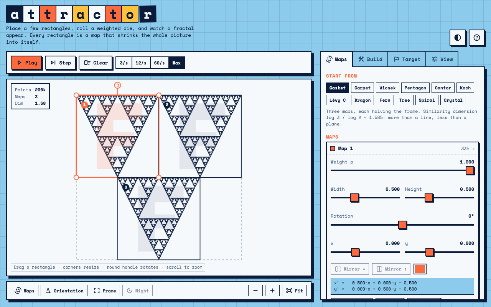</a><br><b><a href="https://labs.matephis.com/attractor-lab/">Attractor Lab</a></b> · <a href="attractor-lab/">code</a><br>Build fractals with iterated function systems and watch the attractor appear.<br><i>Costruisci frattali con i sistemi di funzioni iterate e guarda comparire l'attrattore.</i><br><sub>mathematics · <i>being updated</i></sub></td>
<td width="50%" valign="top"><a href="carts-lab/">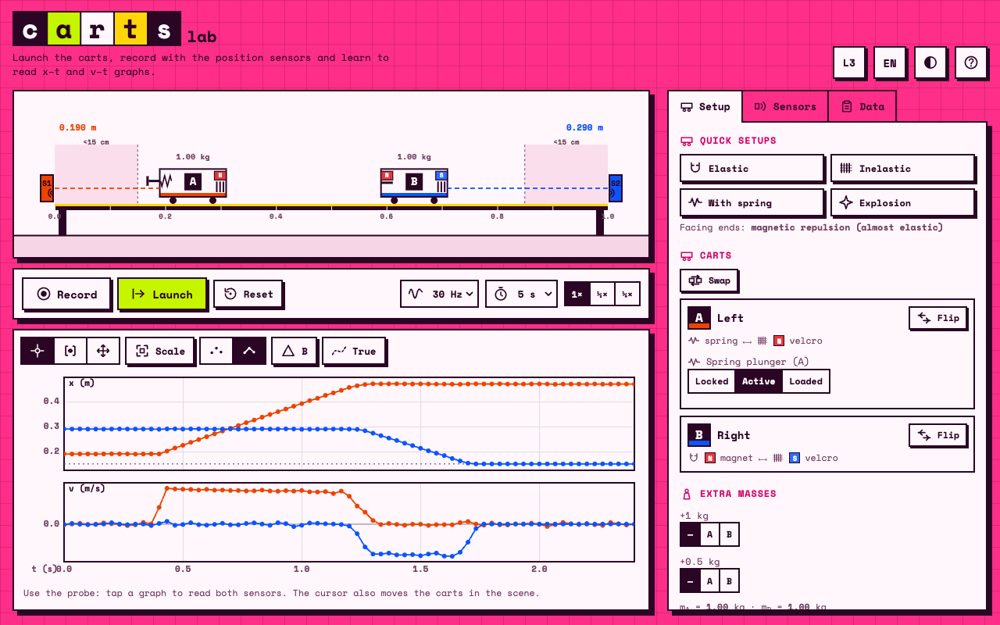</a><br><b><a href="https://labs.matephis.com/carts-lab/">Carts Lab</a></b> · <a href="carts-lab/">code</a><br>Two carts on a rail: collisions, x–t and v–t graphs, momentum conservation.<br><i>Due carrelli su una rotaia: urti, grafici x–t e v–t, conservazione della quantità di moto.</i><br><sub>physics · <i>being updated</i></sub></td>
</tr>
<tr>
<td width="50%" valign="top"><a href="crackler/">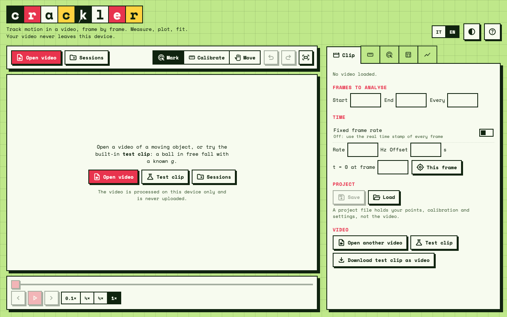</a><br><b><a href="https://labs.matephis.com/crackler/">Crackler</a></b> · <a href="crackler/">code</a><br>Video analysis for physics: calibrate, mark the object frame by frame, measure and fit.<br><i>Videoanalisi per la fisica: calibra, segna l'oggetto fotogramma per fotogramma, misura e interpola.</i><br><sub>physics · <i>being updated</i></sub></td>
<td width="50%" valign="top"><a href="detach-lab/">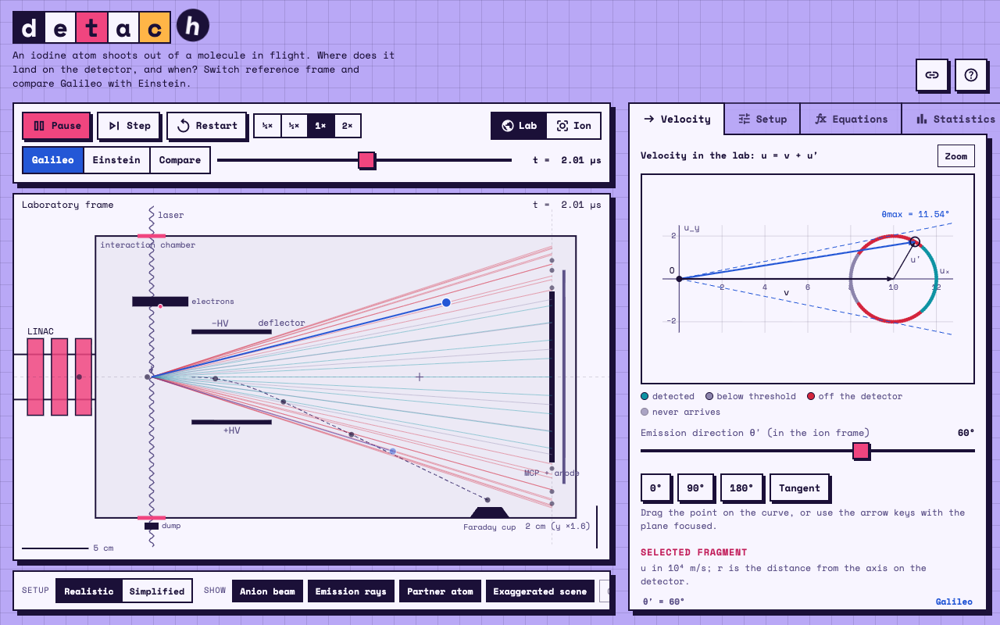</a><br><b><a href="https://labs.matephis.com/detach-lab/">Detach Lab</a></b> · <a href="detach-lab/">code</a><br>Photodetachment of an I₂⁻ beam: where and when the atoms land, Galileo vs Einstein.<br><i>Fotodistacco di un fascio di I₂⁻: dove e quando arrivano gli atomi, Galileo contro Einstein.</i><br><sub>physics · <i>being updated</i></sub></td>
</tr>
<tr>
<td width="50%" valign="top"><a href="impulse-lab/">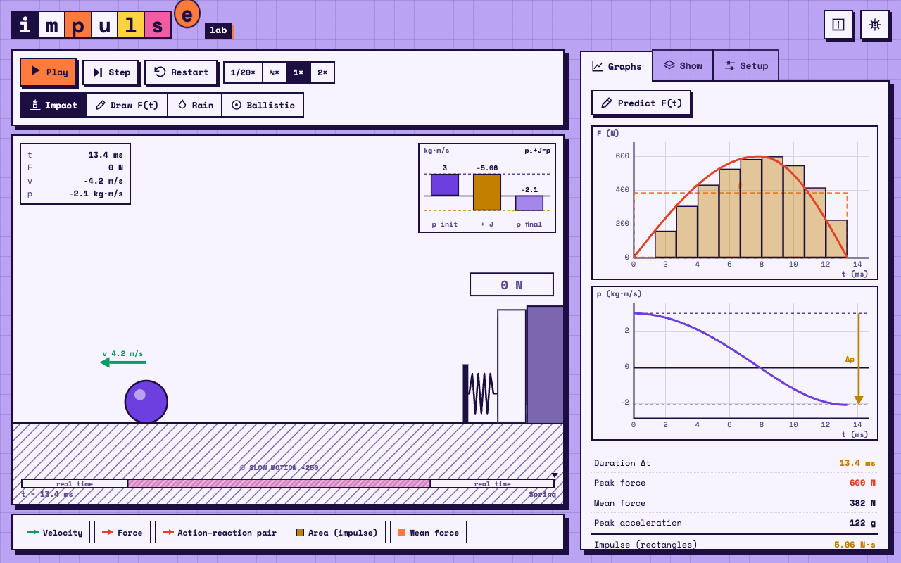</a><br><b><a href="https://labs.matephis.com/impulse-lab/">Impulse Lab</a></b> · <a href="impulse-lab/">code</a><br>Impulse, momentum and collisions: the area under F(t) is Δp.<br><i>Impulso, quantità di moto e urti: l'area sotto F(t) è Δp.</i><br><sub>physics</sub></td>
<td width="50%" valign="top"><a href="metric-lab/">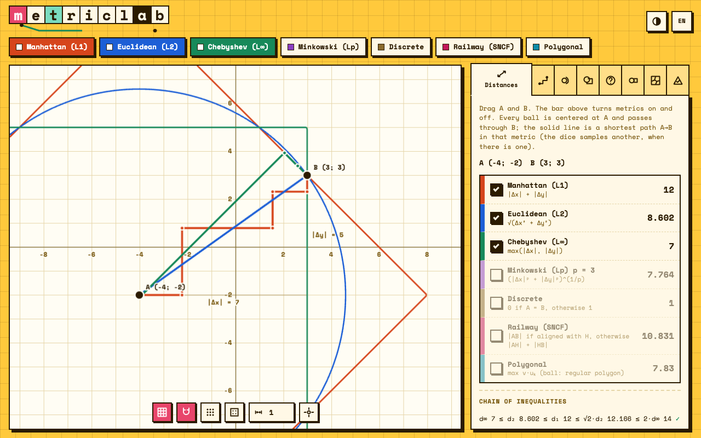</a><br><b><a href="https://labs.matephis.com/metric-lab/">Metric Lab</a></b> · <a href="metric-lab/">code</a><br>Explore and compare definitions of distance on the plane.<br><i>Esplora e confronta diverse definizioni di distanza nel piano.</i><br><sub>mathematics · <i>being updated</i></sub></td>
</tr>
<tr>
<td width="50%" valign="top"><a href="motus1d-lab/">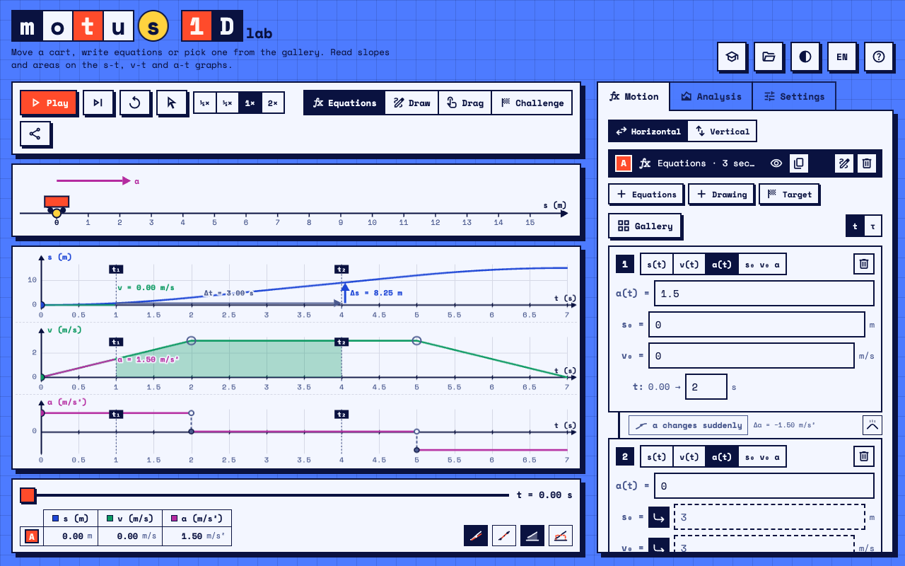</a><br><b><a href="https://labs.matephis.com/motus1d-lab/">Motus 1D Lab</a></b> · <a href="motus1d-lab/">code</a><br>Motion along a line with linked s–t, v–t and a–t graphs.<br><i>Moto su una retta con i grafici s–t, v–t e a–t collegati.</i><br><sub>physics · <i>being updated</i></sub></td>
<td width="50%" valign="top"><a href="orbit-lab/">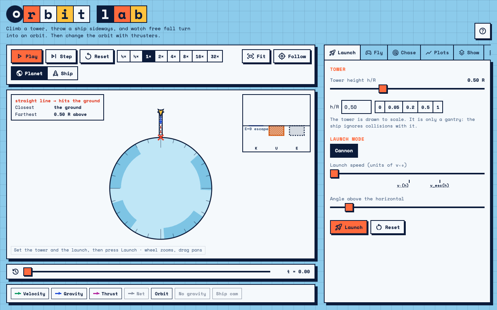</a><br><b><a href="https://labs.matephis.com/orbit-lab/">Orbit Lab</a></b> · <a href="orbit-lab/">code</a><br>Launch a ship around a planet and discover what an orbit is.<br><i>Lancia una navicella attorno a un pianeta e scopri che cos'è un'orbita.</i><br><sub>physics · <i>being updated</i></sub></td>
</tr>
<tr>
<td width="50%" valign="top"><a href="orbit-lab-xr/">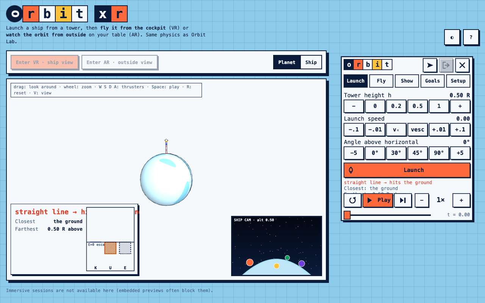</a><br><b><a href="https://labs.matephis.com/orbit-lab-xr/">Orbit Lab XR</a></b> · <a href="orbit-lab-xr/">code</a><br>Orbit Lab in WebXR, for Meta Quest.<br><i>Orbit Lab in realtà virtuale, per Meta Quest.</i><br><sub>physics · XR · <i>being updated</i></sub></td>
<td width="50%" valign="top"><a href="pendulum-lab/">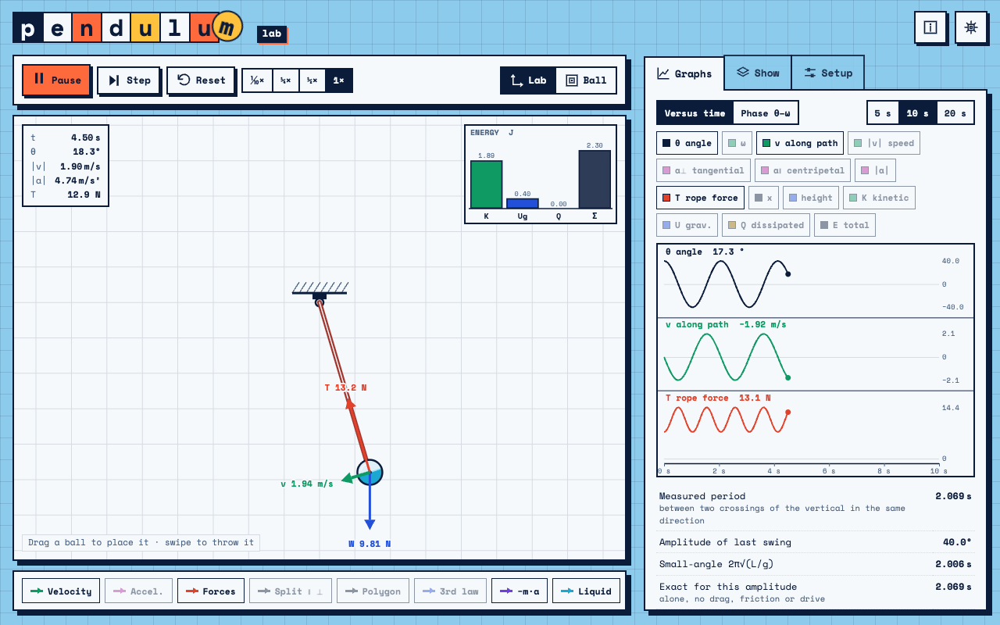</a><br><b><a href="https://labs.matephis.com/pendulum-lab/">Pendulum Lab</a></b> · <a href="pendulum-lab/">code</a><br>Swing a pendulum, watch every force and its third-law partner.<br><i>Fai oscillare un pendolo, guarda ogni forza e la sua coppia del terzo principio.</i><br><sub>physics</sub></td>
</tr>
<tr>
<td width="50%" valign="top"><a href="quadrature/">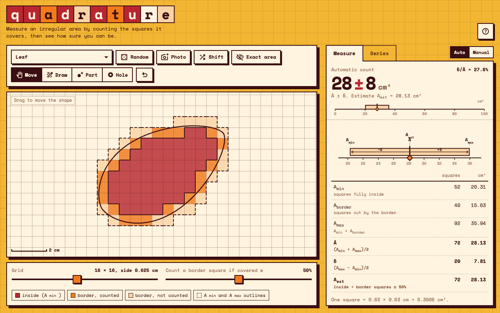</a><br><b><a href="https://labs.matephis.com/quadrature/">Quadrature</a></b> · <a href="quadrature/">code</a><br>Measure an area by counting grid squares, and see how sure you can be.<br><i>Misura l'area di una figura contando i quadretti, e scopri quanto puoi esserne sicuro.</i><br><sub>mathematics · <i>being updated</i></sub></td>
<td width="50%" valign="top"><a href="relative-motion-lab/">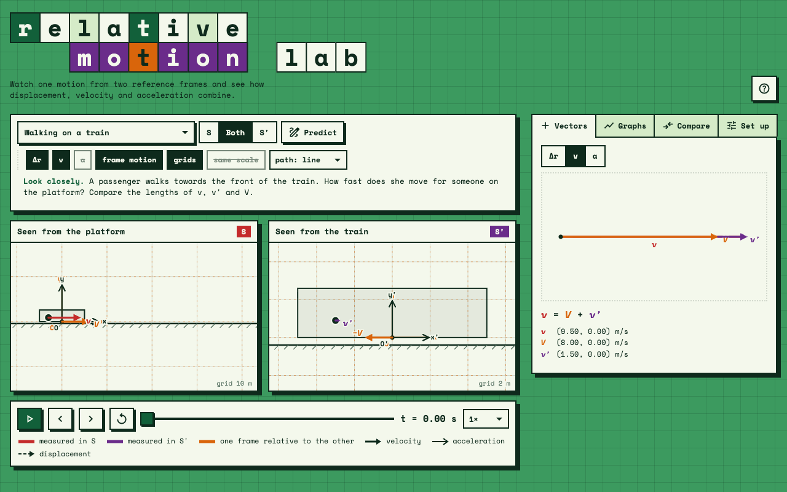</a><br><b><a href="https://labs.matephis.com/relative-motion-lab/">Relative Motion Lab</a></b> · <a href="relative-motion-lab/">code</a><br>One motion seen from two reference frames.<br><i>Un solo moto visto da due sistemi di riferimento.</i><br><sub>physics · <i>being updated</i></sub></td>
</tr>
<tr>
<td width="50%" valign="top"><a href="surface-lab-xr/">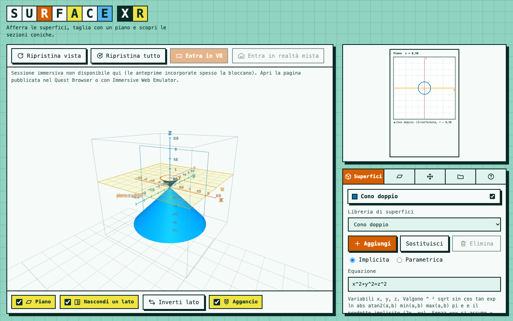</a><br><b><a href="https://labs.matephis.com/surface-lab-xr/">Surface Lab XR</a></b> · <a href="surface-lab-xr/">code</a><br>Quadric surfaces and conic sections in 3D, on desktop or Meta Quest.<br><i>Superfici quadriche e sezioni coniche in 3D, sul computer o con Meta Quest.</i><br><sub>mathematics · XR · <i>being updated</i></sub></td>
<td width="50%" valign="top"><a href="units-lab/">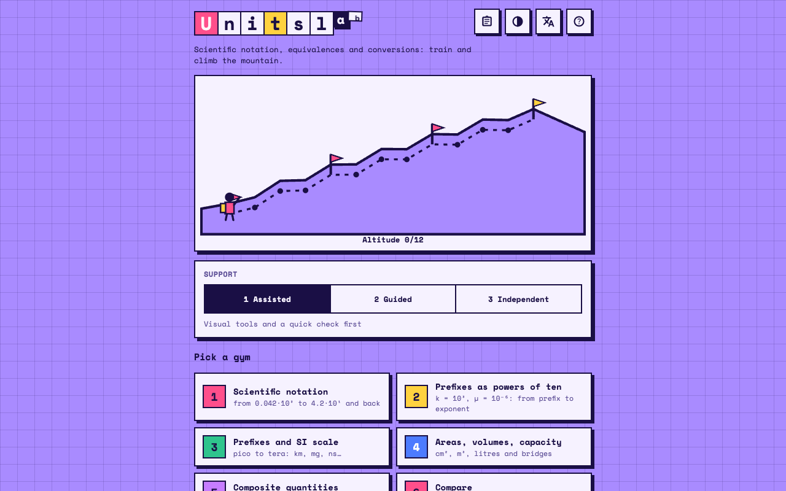</a><br><b><a href="https://labs.matephis.com/units-lab/">Units Lab</a></b> · <a href="units-lab/">code</a><br>Scientific notation and unit conversions, one correct answer at a time.<br><i>Notazione scientifica ed equivalenze tra unità di misura, una risposta giusta alla volta.</i><br><sub>physics · <i>being updated</i></sub></td>
</tr>
<tr>
<td width="50%" valign="top"><b><a href="https://labs.matephis.com/series-lab/">Series Lab</a></b> · <a href="series-lab/">code</a><br>Partial sums of a complex series in the Argand plane: write the general term and watch the polygonal path converge (or not).<br><i>Somme parziali di una serie complessa nel piano di Gauss: scrivi il termine generale e guarda la spezzata convergere (o no).</i><br><sub>mathematics</sub></td>
<td width="50%" valign="top"></td>
</tr>
</table>
<!-- labs:end -->

Labs marked *being updated* still have their previous look; they are being brought in line with the shared standard one by one.

## How this repository works

```
ROADMAP.md       what is done and what comes next; docs/LANDING.md is the landing page plan
DESIGN.md        the design standard every lab follows (look, components, language, plots, PWA, files)
MIGRATION.md     how an existing lab is brought in line with the standard, with notes for each lab
apps.json        the list of labs: names, descriptions, palettes, test commands
kit/             the shared kit: styles, components, settings menu, language, theme, fonts, icons
index.html       the home page of labs.matephis.com
demo.html        every kit component in both themes, and the palette board
template/        starting files for a new lab; template/single-file.html is the one-file starter for prototyping
tools/           checks, tests, screenshots, service workers, new labs
<lab>/           one folder per lab, with its own README
```

Run everything locally (no build step, no dependencies):

```sh
python3 -m http.server 8100
# home page http://localhost:8100/ · a lab http://localhost:8100/pendulum-lab/ · the kit http://localhost:8100/demo.html
```

Useful commands (Node 22+):

| Command | Does |
|---|---|
| `node tools/test-all.mjs` | kit tests, every lab's tests and the conformance check (as CI does) |
| `node tools/check-app.mjs <lab>` / `--all` | how a lab measures up to DESIGN.md |
| `node tools/sync-kit.mjs <lab>` | regenerates the lab's manifest and offline service worker |
| `node tools/screenshot.mjs [lab…]` | `docs/screenshot.png` of each lab (headless Chrome) |
| `node tools/readme.mjs` | rebuilds the gallery above from `apps.json` |
| `node tools/new-app.mjs <lab>` | a new lab from `template/` |

Every push to `main` runs the tests and checks on GitHub Actions and, if they pass, publishes the site.

## Licence

MIT, see `LICENSE`. Space Mono font: SIL Open Font License (`kit/fonts/LICENSES.txt`).
