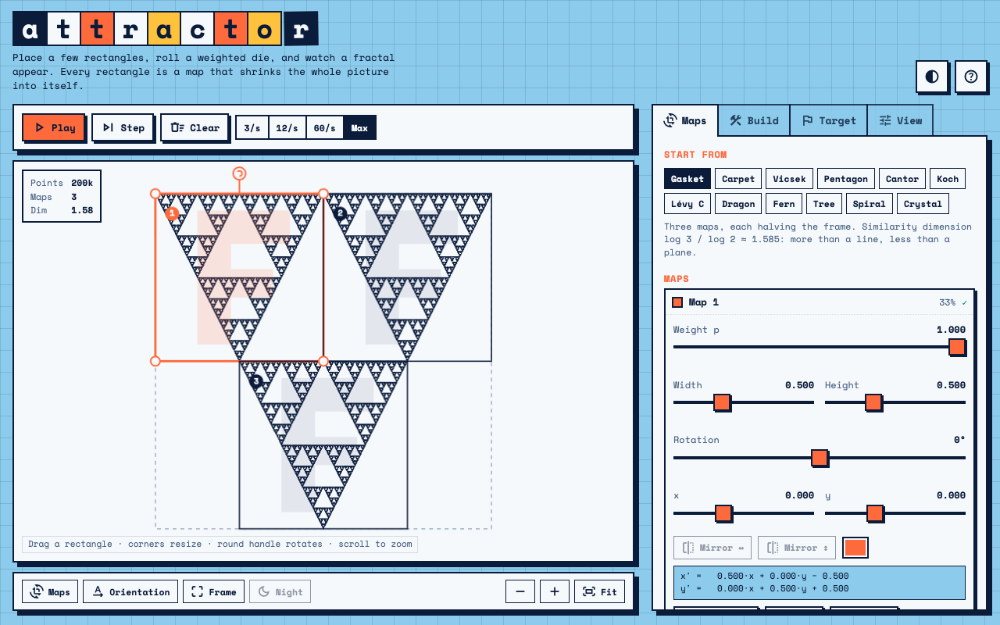

# Attractor Lab



An interactive lab for building fractals with Iterated Function Systems (IFS). Place a few rectangles, each one a map that shrinks the whole picture into itself, and watch the attractor appear. Same visual family as Pendulum Lab and Quadrature.

## What you can do

*   **Edit maps directly**: drag, resize and rotate rectangles on the canvas, or use the sliders. An F inside each rectangle shows how the map turns or mirrors the frame. The matrix of every map is shown in school coordinates.
*   **Watch the chaos game**: slow it down to 3 points per second and see the die roll, the chosen map flashing, the burn-in points drawn hollow, and the attractor taking shape.
*   **Build it level by level**: the Levels method draws a starting shape (F, square, triangle) and replaces every copy by its images under all maps. Different seeds converge to the same attractor.
*   **See the maths**: contraction check per map, similarity dimension (solving Σ rᵢᵈ = 1) with a note when it is only an estimate, and weight tools (equal, by area, sum to 1).
*   **Collage challenge**: cover the ghost of a target fractal and get an overlap score, an interactive take on the collage theorem.
*   **Zoom and pan** to see self-similarity, with density-based rendering that stays sharp at depth.
*   **Presets**: gasket, carpet, Vicsek, pentagon, Cantor, Koch, Lévy C, dragon, fern, tree, spiral, crystal.
*   **Share and save**: link that stores the maps in the address, PNG export, JSON save and load (compatible with the old format).

Keys: `Space` play/pause, `S` step, `C` clear, `N` new map, `Del` remove, `M` toggle maps, `0` fit.

## Run

Static site, no build. ES modules need a server:

```
python3 -m http.server
```

## Note

This project was mostly vibe coded.
