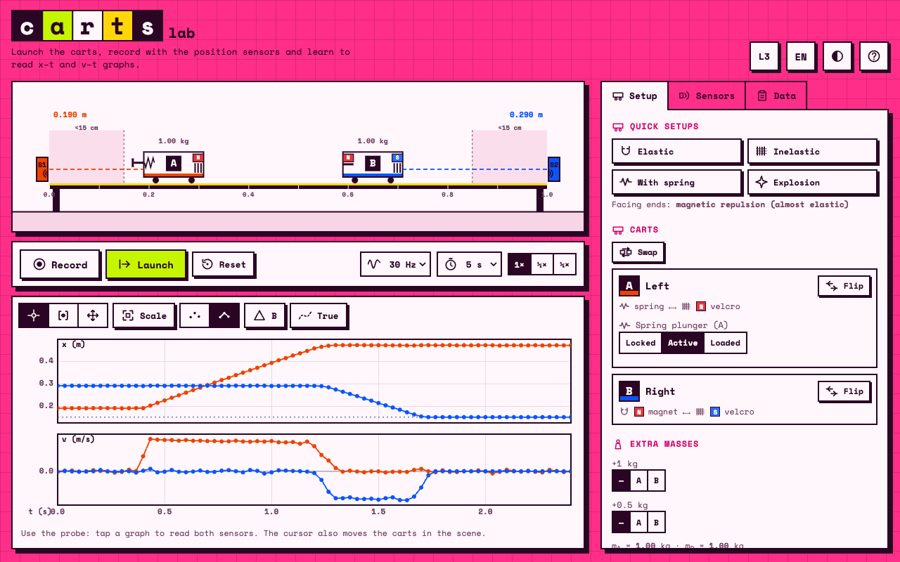

# Carts Lab



A browser simulation of two carts on a low-friction rail with a position sensor at each end. Launch the carts, let them collide, and record sampled **x–t** and **v–t** graphs the way a real data logger would. The goal is to practise reading position and velocity graphs, extracting velocities and accelerations, and checking momentum conservation.

No build step, no dependencies: plain ES modules, canvas 2D, and a small physics engine. Interface in Italian and English, light and dark themes, works on phones.

## Features

**Experiment**
- Two carts with a spring plunger, velcro and magnet faces: elastic, inelastic, spring and "explosion" set-ups, each cart can be flipped and the two swapped.
- Extra masses (1 kg and 0.5 kg), adjustable rail length, tilt (height difference of the two feet), rolling friction.
- Launch by dragging or swiping a cart, by entering speeds, or with the plunger. Carts that reach the end of the rail derail.
- Optional hidden cart masses (set by a seed) and a digital scale with 1 g resolution and a small scatter.

**Sensors and recording**
- Sensors exactly at the rail ends, 0.15 m dead zone (the sensor reports the minimum distance), Gaussian noise, 10–40 Hz sampling.
- Velocity computed from the position samples with a three-point central difference, as a logger does.
- Start manually or with a motion trigger (adjustable threshold).
- Per-sensor sign inversion.

**Graph analysis**
- Shared time axis, autoscale, points or joined points, probe cursor (and a second cursor for differences and slope), pan and zoom.
- Moving the probe replays the carts in the scene at that instant.
- Interval selection with constant, linear and quadratic least-squares fits (slope or acceleration with standard error and R²), non-destructive crop.
- Several runs overlaid (the active one opaque), optional alignment of the starts, optional overlay of the true motion.

**Feature levels**
A header button cycles three levels that progressively reveal tools: *Reading*, *Analysis*, *Full*. The level is stored in the URL hash (`#livello-1` … `#livello-3`, or `#level-1` … `#level-3`), so a link can open the app at a given level. The table of which feature appears at which level is `FEATURES` in `js/config.js`.

## Run locally

ES modules need an HTTP server (opening `index.html` from the file system will not work):

```sh
npm run serve        # python3 -m http.server 8000
# open http://localhost:8000
```

## Tests

```sh
npm test
```

Node tests cover the physics (momentum and energy in elastic collisions, inelastic velcro, spring and explosion, friction and compensating tilt, static friction, derailing), the sensors and recorder, the numerical derivative, the fits, noise statistics, hidden masses, the scale and the trigger. No packages are needed.

## Project layout

```
index.html        page, styles and markup
js/config.js      constants of the model and the feature-level table
js/physics.js     World: carts, forces, friction, tilt, derailing (fixed step 0.2 ms)
js/sensors.js     sensor model, recorder, derivative, hidden masses, scale
js/fit.js         polynomial least squares
js/scene.js       rail and carts: drawing and dragging
js/graphs.js      graphs, cursors, selection, interaction
js/main.js        state, panels, recording, levels, trigger
js/i18n.js        Italian and English strings
js/icons.js       inline SVG icons
tests/            Node tests
docs/MODEL.md     physical model and how to calibrate it
fonts/            Space Mono (SIL Open Font License)
```

## Model and calibration

See [docs/MODEL.md](docs/MODEL.md). The constants (noise, friction, magnet and spring strength) are plausible estimates, meant to be tuned against real recordings by editing `js/config.js`.

## Deployment

The app is static. A GitHub Actions workflow (`.github/workflows/pages.yml`) runs the tests and publishes `index.html`, `js/` and `fonts/` to GitHub Pages when `main` is updated. In the repository settings, set *Pages → Source* to *GitHub Actions*.

## License

Code: MIT, see `LICENSE`. Fonts: Space Mono, SIL Open Font License 1.1, see `fonts/OFL.txt`.
