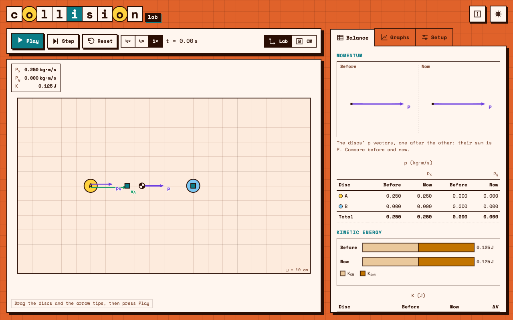

# Collision Lab



Collisions in two dimensions on an air table: momentum, centre of mass and the energy that is lost.

Where [Carts Lab](../carts-lab/) reproduces one experiment on a rail with sensors and data analysis, and [Impulse Lab](../impulse-lab/) looks inside a single collision (the force over time), Collision Lab is about **what is conserved**: discs move freely on a table seen from above, and every collision is checked against the balance of momentum and kinetic energy, in the lab frame and in the centre-of-mass frame.

Part of the math and physics labs at [labs.matephis.com](https://labs.matephis.com). Interface in Italian and English, light and dark themes, works on phones and offline, installable as an app.

## Features

- **Five experiments**: head-on (1D), glancing (target at rest, impact parameter b), free (any positions and velocities), explosion (one body splits in two, released energy E), break (a disc hits a triangle of 3, 6 or 10 discs).
- **Set up by hand**: drag the discs and the tips of their velocity arrows on the table, or use the sliders.
- **Coefficient of restitution** e from 0 to 1, or discs that **stick** (velcro): the pair becomes one rigid body and spins after an off-centre hit.
- **Bumpers** on or off: with bumpers the system is no longer isolated and the external impulse they give is shown.
- **Lab and centre-of-mass frames**: in the CM frame the table slides under the discs and every momentum comes in pairs of opposite vectors.
- **Balance tab**: momentum vectors head to tail before and now (their sum is P), tables of p and K for every disc, and kinetic energy split into K_CM = P²/2M (which no collision can remove) and the internal part.
- **Graphs tab**: x, y, v_x, v_y, p_x, p_y or K over time for every disc, with the total (or, for positions, the centre of mass), collision instants marked; CSV export of positions, velocities, centre of mass and totals (Italian: `;` and decimal comma).
- Strobe photo (one image every 0.1 s), trails, centre of mass and its path, velocity and momentum vectors.
- **Shareable link**: the whole set-up travels in the URL hash, so a link or a QR code (settings menu → Show QR code) opens the same scene on every device. See below.

## Links to a prepared scene

The hash holds the physical set-up (`s` scene, its parameters, `e`, `st` stick, `w` bumpers, `f` frame `lab` or `cm`) and, optionally, how the scene is presented:

| Key | Values | Effect |
|---|---|---|
| `show` | some of `mom,vel,cm,trail,strobe` | display switches for this session (the saved preference is not changed) |
| `tab` | `0`, `1`, `2` | panel open at the start (Balance, Graphs, Setup) |
| `g` | `x`, `y`, `vx`, `vy`, `px`, `py`, `K` | quantity in the graph |
| `hide` | some of `e,bal,gr,num,vec` | hides the value of e, the Balance tab, the Graphs tab, the numbers, the vectors; a "Show" button reveals them after asking for a prediction |
| `lock` | `1` | sliders and dragging disabled; play, reset, frame and display switches still work |

**Presets**: `#p=<id>` opens a named scene from `js/presets.js` (title and note in both languages, shown above the table). The preset is applied after the defaults and before any key written after it, so `#p=urti/s1&e=0.3` is that scene with e = 0.3. The app keeps such a link short (`#p=…` plus what changed), so a value a preset hides does not appear in the address. Presets: `urti/s1` … `urti/s11` (head-on elastic, inelastic and sticking collisions, a collision with a hidden e, light against heavy and the reverse, explosions from rest and in motion, glancing collisions).

Links written by earlier versions open exactly as before. A QR code for printing: `node tools/qr.mjs "<url>" out.svg` from the repository root.

## Run locally

```bash
# from the repository root
python3 -m http.server 8100
```

Then open <http://localhost:8100/collision-lab/>. Tests: `node --test tests/`.

## Structure

```
index.html            markup and the info dialog
css/app.css           palette, disc colours and app-specific styles
js/main.js            entry point: kit start-up, controls, simulation loop, dragging, panel refresh
js/physics.js         discs and rigid clusters, exact contact times, impulses, sticking, explosions, bumpers
js/scenes.js          the five experiments: parameters, starting discs, drag handles
js/state.js           settings and their URL hash form (physical and presentation keys)
js/presets.js         named scenes for links (#p=…)
js/quantities.js      the quantities of the time graph
js/render.js          the table, discs, strobe, trails, vectors, centre of mass
js/panels.js          momentum diagram, tables, energy bars, time graph, CSV
js/strings.js         Italian and English strings
logo.svg              animated logo (favicon and icons are generated from it)
sw.js, manifest.webmanifest   offline and install (generated)
docs/MODEL.md         the physical model
tests/                node --test
```

The look and behaviour follow the shared [lab design standard](../DESIGN.md).

## Licence

MIT, see [LICENSE](LICENSE). Space Mono font: SIL Open Font License (`../kit/fonts/LICENSES.txt`).

Vibecoded with Claude, with <3.
