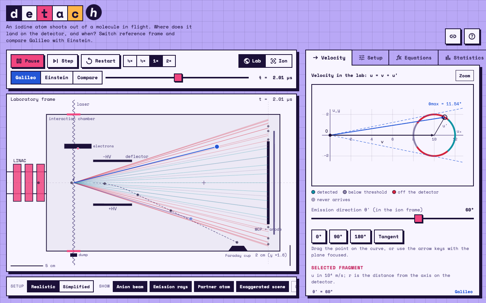

# Detach Lab



An interactive web app to explore the **dissociative photodetachment** of an I₂⁻ beam and what it teaches about relative motion. A beam of I₂⁻ anions moves along $x$ with speed $v$. A laser removes an electron; the neutral I₂ breaks apart and an iodine atom leaves with speed $u'$ (in the ion's frame) in an arbitrary direction. A flat detector at distance $L$ records where and when the atoms arrive. Where do they land, and why? Change the reference frame and compare Galileo with Einstein.

Plain HTML, CSS and vanilla JavaScript: no build step, no framework.

## Features

- **Apparatus reconstruction** in two flavours: *realistic* (accelerator, interaction chamber, laser ports, electron detector, deflector plates, Faraday cup, MCP and anode) and *simplified*.
- **Two reference frames**, laboratory and ion, also shown side by side. In the ion frame the detector, laser and deflector move at $-v$.
- **Anion beam**: bunches cross the laser, some lose the electron, the others are bent by the deflector into the cup.
- **Continuous flow**: time never stops, bunches keep arriving and fragments leave in random directions, building up hits on the detector.
- **Galilean, relativistic or both models**, with a relative-difference table when comparing. With the real $c$ the models differ by about $10^{-7}$, so a *reduced $c$* ($\beta = v/c$ slider) makes the difference visible.
- **Velocity plane**: the tips of the fragment velocities lie on a circle (Galileo) or an ellipse (Einstein); drag a point to choose the emission direction.
- **Equations tab**: step-by-step algebra rendered with MathJax: the circle, $t = L/x$, $r = Ly/x$, the two solutions for a given $r$, the energy threshold, the condition $r \le R$ and the minimum detector radius, with plots of $r(x)$ and $t(x)$.
- **Statistics tab**: histograms of the time of flight and of the impact distance for an isotropic sample of emissions (the sample grows with time in continuous flow). Arrivals pile up near the extreme values: the signature of the two solutions for a given $r$.
- **Picking**: click a mark on the detector (or an emission-ray dot) to read $\theta'$, $t$, $r$, $E$ and the outcome of that fragment.
- **Shareable setups**: the whole configuration is stored in the URL hash; the link button copies an address that reproduces what you see.
- **English and Italian** interface (toggle in the help dialog; the choice is remembered).
- Light and dark theme following the system setting, responsive layout.

## Physics in brief

Units: speeds in $10^4\,\mathrm{m/s}$ ($=1\,\mathrm{cm/\mu s}$), distances in cm, times in $\mu$s.

In the laboratory $\vec u = \vec v + \vec u'$, so the fragment velocities satisfy

$$(u_x - v)^2 + u_y^2 = u'^2 .$$

A fragment with $u_x = x$ reaches the detector at $t = L/x$ and at distance $r = L\,y/x$ from the axis. The maximum emission angle seen in the lab is $\sin\theta_{max} = u'/v$ for $v > u'$, hence $r_{max} = L\tan\theta_{max}$.

The relativistic composition gives, with $D = 1 + v u'\cos\theta'/c^2$,

$$u_x = \frac{v + u'\cos\theta'}{D}, \qquad u_y = \frac{u'\sin\theta'}{\gamma D},$$

and in the ion frame the detector distance contracts to $L/\gamma$.

Detection energy uses the iodine mass (127 u): $E[\mathrm{keV}] \approx 0.0658\,u^2$ with $u$ in $10^4\,\mathrm{m/s}$.

## Run it

Open `index.html` in a browser, or serve the folder:

```sh
python3 -m http.server 8000
```

then visit <http://localhost:8000>. An internet connection is needed for the fonts (Google Fonts) and for MathJax (cdnjs); the simulation itself works without them, but icons and equations will not render.

### GitHub Pages

Push the repository, then enable *Settings → Pages → Deploy from a branch* on `main` (root). The app is served as is.

## Structure

```
index.html            markup and script loading order
css/style.css         theme tokens (light/dark) and layout
js/state.js           shared state, language, number formatting
js/physics.js         Galilean/relativistic composition, detector model
js/canvas.js          canvas helpers
js/anions.js          animation clock, anion bunches, deflection
js/scene.js           apparatus drawing (lab / ion frame)
js/velocity.js        velocity plane
js/tables.js          readout table and summary
js/equations.js       equation cards (MathJax)
js/equation-plot.js   r(x) and t(x) plots
js/stats.js           histograms
js/share.js           URL hash state and link copy
js/ui.js              controls, language switch, animation loop
```

The scripts are plain classic scripts that share one global scope and must be loaded in the order listed in `index.html`.

## License

MIT, see [LICENSE](LICENSE).
