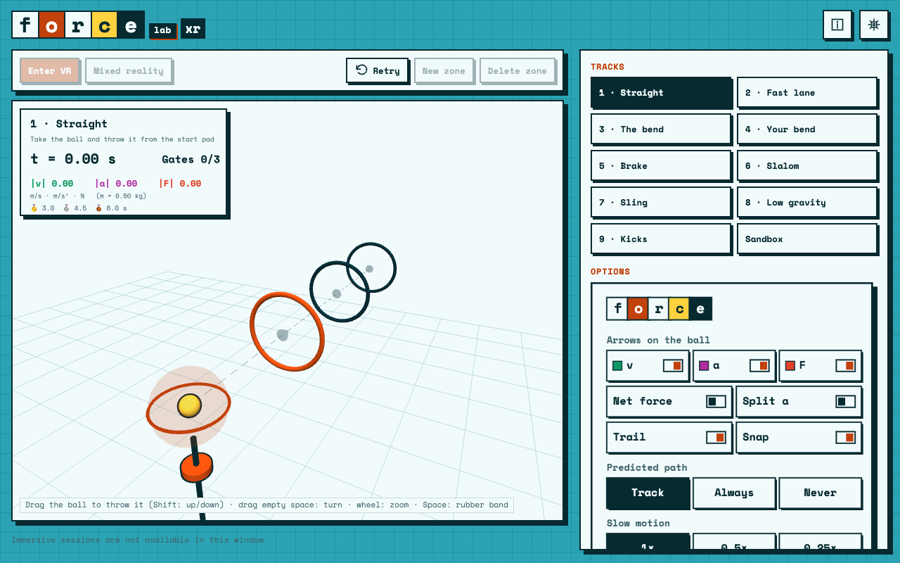

# Force Lab XR (prototype)



Throw a ball and steer it through a track of gates with **force zones** and a **rubber band**. Three arrows ride on the ball:
velocity **v**, acceleration **a** and net force **F**: the acceleration always points where the net force points, the velocity does not.
Runs in the Quest Browser (WebXR, controllers or hands, VR or mixed reality) and on a computer. Interface in Italian and English,
works offline. No build step: plain HTML, CSS and JavaScript, Three.js r128 bundled.

Part of the math and physics labs: the look and behaviour follow the shared [lab design standard](https://github.com/Bradwave/labs/blob/main/DESIGN.md).

## Features
- **Throw** the ball: it leaves with your hand's velocity (estimated over the last tenth of a second). The clock starts when you let go on the start pad; catching the ball in flight cancels the run.
- **Force zones**: boxes with one uniform force in newtons (so the ball's mass matters); drag the arrow's tip for direction and strength, the corner for the size; overlapping zones add up. Snapping to axes and diagonals, 0.05 N steps.
- **Rubber band** from the ball to your hand: slack (it dangles) until you stretch it beyond its rest length plus a dead zone (0–10 cm, in the options), then F = k·stretch. If your hand leaves the headset's view while pulling, the band keeps pulling from where it was last seen, so you can swing the ball around you.
- **Kicks**: close your fist and snap it open with the palm toward the ball (or double-tap the trigger) for an impulse J = F·Δt; the ball's velocity jumps by Δv = J/m in the direction of the kick.
- **9 tracks** of increasing difficulty, each about one idea (first law, speed, force across v, force against v, alternating forces with a time limit, circular motion, weight, impulse), plus a sandbox. Speed gates, a stop target, time limits, medals.
- **Readings**: v, a, F arrows, each force separately, a split into the parts along and across v, a strobe trail, a predicted path, slow motion, low or Earth gravity and ball mass in the sandbox.
- **Small rooms**: grab the knob under the start pad (controller grip, pinch or fist) to move and turn the whole track, resize it with the other hand, or pick a size (50–150 %) in the options; it shrinks around the start pad, so nobody has to walk. The physics does not change (a half-size track wants half-speed throws).

## Run
```bash
python3 -m http.server 8100      # in the repository root, then open http://localhost:8100/force-lab-xr/
```
Quest over USB: `adb reverse tcp:8100 tcp:8100`, open `http://localhost:8100/force-lab-xr/` in the Quest Browser. `?monitor=1` shows the raw buttons, axes and palm direction.
Tests (plain Node): `node tests/physics.test.mjs && node tests/tracks.test.mjs && node tests/input.test.mjs && node tests/panel.test.mjs`.

## Not verified on a headset
Everything XR was checked only with simulated controllers and hands: button indices, thumbstick axes, palm-up sign, pinch and fist thresholds,
throw feel, panel sizes and distances, rubber band stiffness, frame rate.
