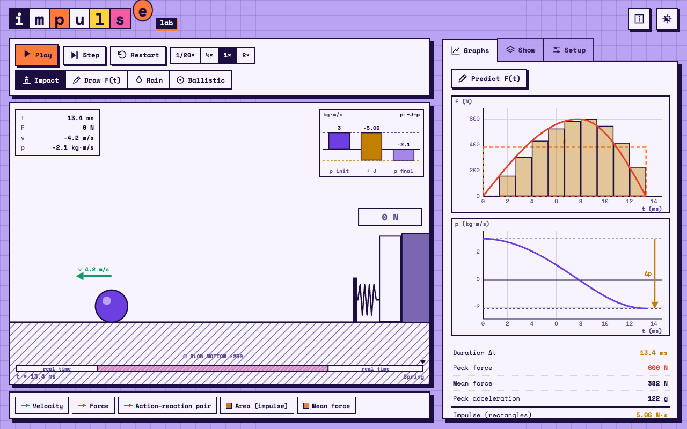

# Impulse Lab



An interactive web app for exploring **impulse, momentum and collisions**. It runs entirely in the browser (vanilla JavaScript, no framework, no server) and is available in Italian and English.

The central idea is that a force acting for a short time changes momentum: $J=\int F\,dt=\Delta p$. The area under the $F(t)$ curve is shown by default as a **sum of rectangles**; you can switch to the exact integral or to a simulated datalogger with a chosen sampling rate.

## Scenes

- **Impact**: an object hits a sensor. The contact is shown in slow motion (or in real time) and the force–time curve changes shape and height while the area stays $\Delta p=mv_0(1+e)$. Includes presets (ball, clay, egg, car, tennis) and a *steering wheel vs airbag* comparison with a force limit.
- **Draw F(t)**: set the force interval by interval and see the cart's $p(t)$, $v(t)$, $x(t)$, with a challenge mode. Forces are shown as thrusters with the reaction on the expelled gas.
- **Rain**: many small impulses add up to a nearly constant force on a scale; compare with the theory and the $e=0$ case.
- **Ballistic**: a bullet embeds in (or bounces off) a pendulum block; momentum, energy and swing height are compared.

Other features: action–reaction pairs drawn on the bodies that receive them, momentum and energy bars, real sensor data (paste *time, force* columns and compare their area with $\Delta p$), sketch-your-prediction of $F(t)$ before running the simulation, moving average, shareable links that restore the scene and its parameters, image export, light/dark/auto theme, keyboard shortcuts.

## Run it

Serve the repository root and open the lab (ES modules do not load from `file://`, and the page loads the shared `../kit`):

```sh
python3 -m http.server 8100
# then open http://localhost:8100/impulse-lab/
```

No build step and no dependencies. The app works offline after the first visit and installs as an app (PWA). Light and dark themes, Italian and English: both are in the settings menu (gear). It is part of the math and physics labs and follows the shared [lab design standard](https://github.com/Bradwave/labs/blob/main/DESIGN.md).

Published with the other labs at labs.matephis.com/impulse-lab/ (GitHub Actions, see the repository root).

## Structure

| Path | Content |
| --- | --- |
| `index.html` | page markup and the info dialog |
| `css/app.css` | palette and Impulse-specific styles |
| `kit/` | not in this folder: the shared lab kit lives in `../kit/` |
| `sw.js`, `manifest.webmanifest` | offline and install (generated) |
| `js/boot.js` | starts the kit and exposes it to the app as `window.KIT` |
| `js/strings.js` | every interface string and the help text, Italian and English |
| `js/01-core.js` | utilities, `Plot`, bar charts, controls, area methods, main loop |
| `js/02-…05-*.js` | the four scenes (impact, draw, rain, ballistic) |
| `js/06-app.js` | start-up, tabs, shareable state, image export, keyboard |

The six `js/0*.js` files are classic scripts that share one global scope and run in file order after `js/boot.js`, so shared helpers must live in an earlier file than the code that uses them.

```sh
node --test tests/       # strings: same keys in both languages, no undefined keys
python3 tests/smoke.py   # browser smoke test (needs Playwright for Python and Chromium)
```

## Notes

- Fonts and icons come from the shared kit (`../kit/`): nothing is loaded from other sites.
- The only data stored in the browser (`localStorage`) are the theme and language choices (`impulse-lab.theme`, `impulse-lab.lang`).
- Copied data is tab-separated (it pastes straight into Excel or Sheets), with a decimal comma in Italian.

## License

MIT, see `LICENSE`.
