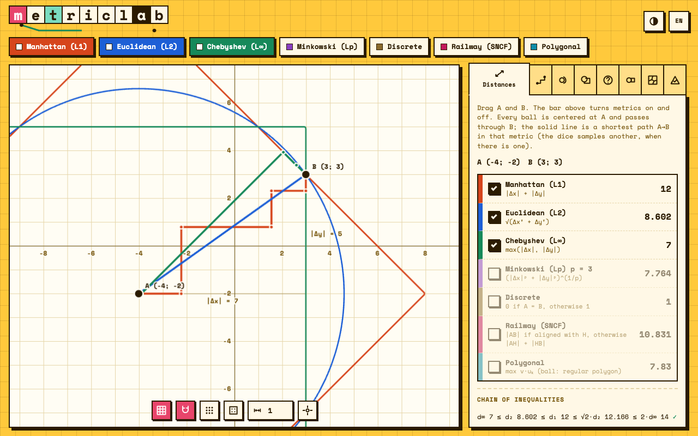

# Metric Lab



An interactive laboratory to explore and compare **definitions of distance** on the plane.
Vanilla JavaScript, no build step, no dependencies. The interface is available in Italian and English, with light and dark themes.

## Metrics

| Metric | Definition |
| --- | --- |
| Manhattan ($L_1$) | $\lvert\Delta x\rvert + \lvert\Delta y\rvert$ |
| Euclidean ($L_2$) | $\sqrt{\Delta x^2 + \Delta y^2}$ |
| Chebyshev ($L_\infty$) | $\max(\lvert\Delta x\rvert, \lvert\Delta y\rvert)$ |
| Minkowski ($L_p$) | $(\lvert\Delta x\rvert^p + \lvert\Delta y\rvert^p)^{1/p}$, with adjustable $p$ |
| Discrete | $0$ if $A = B$, otherwise $1$ |
| Railway (SNCF) | $\lvert AB\rvert$ if $A$, $B$ and the hub $H$ are collinear, otherwise $\lvert AH\rvert + \lvert HB\rvert$ |
| Polygonal norm | $\max_k\, v\cdot u_k$: the unit ball is a regular polygon with an even number of sides |

## Features

The side panel has eight tabs.

- **Distances**: drag two points and compare the distances; the balls through $B$ and a true shortest path $A \to B$ are drawn for every metric that is turned on. A dice button samples another shortest path where it is not unique.
- **Paths**: the region of all shortest paths (the metric interval), extreme paths, random samples, $L_1$ staircases, a probe point, and a path drawn by hand. With the lattice on, the number of shortest lattice paths is counted exactly.
- **Loci**: bisector, circle, ellipse, hyperbola and parabola, defined as loci of the chosen distance. Loci with an interior (for example the $L_1$ bisector) are filled. An animation builds each locus from intersecting balls. Shortest paths from the test point to the foci are drawn.
- **Scene**: several objects, each with its own metric, with intersections (points, overlap regions and tangencies), duplication in other metrics, undo and redo, ready-made examples and SVG export.
- **Predict**: mark the points you expect on a locus, reveal the answer, compare, change metric and discuss. There are no scores.
- **Sets**: distance and Hausdorff distance between points, segments, circles and discs in every metric.
- **Voronoi**: Voronoi diagram for any metric, with equidistant regions highlighted.
- **Axioms**: sample-based search for counterexamples to the metric axioms, on the chosen metric and on four functions that are not distances.

Grid step, snapping to nodes and a lattice mode (only lattice points count) are available on every tab.

## Run

Open `index.html` in a browser, or serve the folder with any static server:

```sh
python3 -m http.server 8000
```

Everything is client side. Fonts are bundled in `fonts/`.

## Tests

The numerical core has no DOM dependency and is tested with plain Node (no packages):

```sh
node tests/core.test.js
```

The tests cover the metric axioms, the chain $d_\infty \le d_2 \le d_1 \le \sqrt2\, d_2 \le 2\, d_\infty$, point-to-line distances, shortest-path lengths, exact lattice path counts, contour and region extraction, and the axiom checker.

## Project layout

```
index.html        page
css/style.css     styles and themes
js/metrics.js     metrics and point-to-line distance
js/field.js       field sampling, contours (marching squares), regions, intersections
js/paths.js       metric interval, shortest-path sampling, lattice counting
js/loci.js        loci as zero sets of distance fields, ball constructions
js/axioms.js      metric axiom checker
js/modes.js       Predict, Sets, Voronoi and Axioms tabs
js/i18n.js        Italian and English strings
js/main.js        canvas, scene, panels and interaction
tests/            Node tests of the core
fonts/            Space Mono (SIL OFL 1.1)
```

The core modules are classic scripts that attach to a global `DL` object, so they load in the browser and in Node without a bundler. Source comments are in Italian.

## Key idea

A locus is the zero set of a scalar field $F(P)$, for example $F = d(P,A) - d(P,B)$ for the bisector. The field is sampled on a pixel grid, curves come from marching squares, and a region is detected when whole cells have $F = 0$ exactly. The same machinery draws every locus, ball, metric interval and intersection.

## Adding a language

Add a block to `T` in `js/i18n.js` with the same keys as `it`, then add the language code to the toggle in `js/main.js`.

## Licenses

Code: MIT, see `LICENSE`. Space Mono is licensed under the SIL Open Font License 1.1, see `fonts/LICENSE.txt`.
