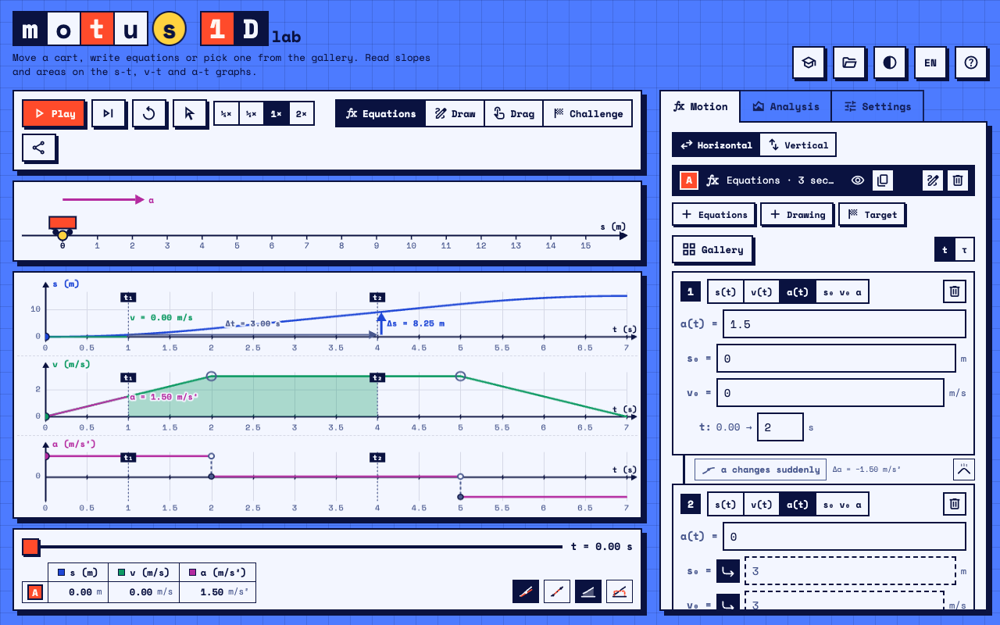
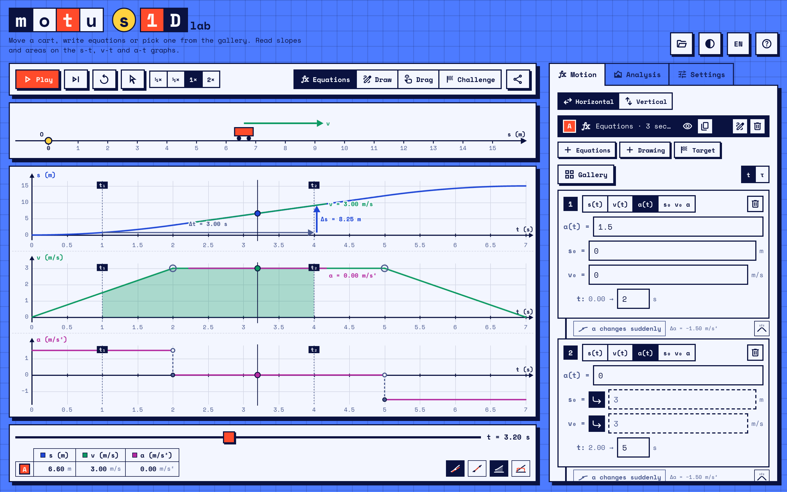
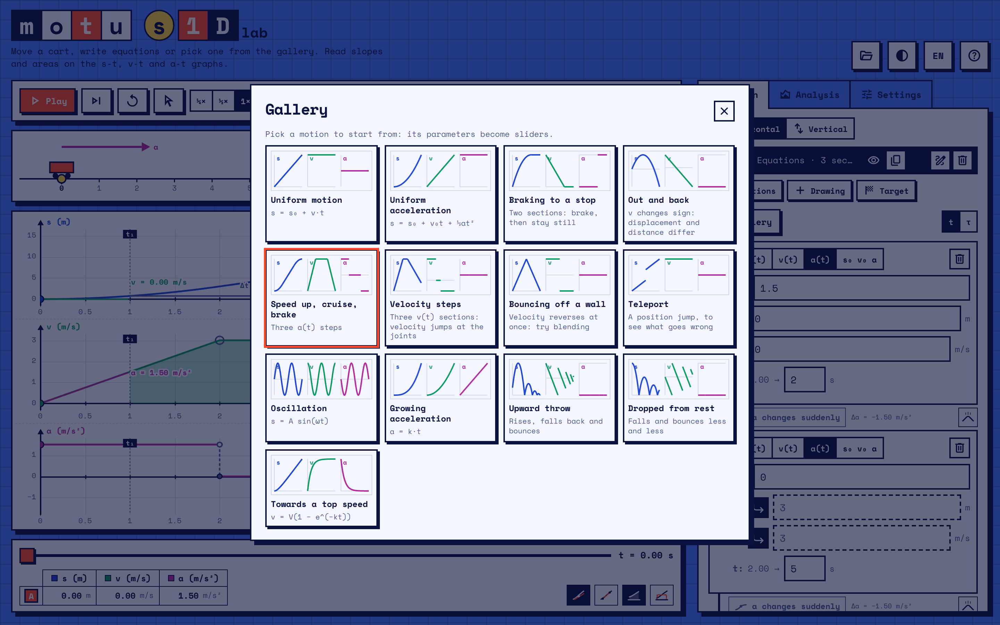
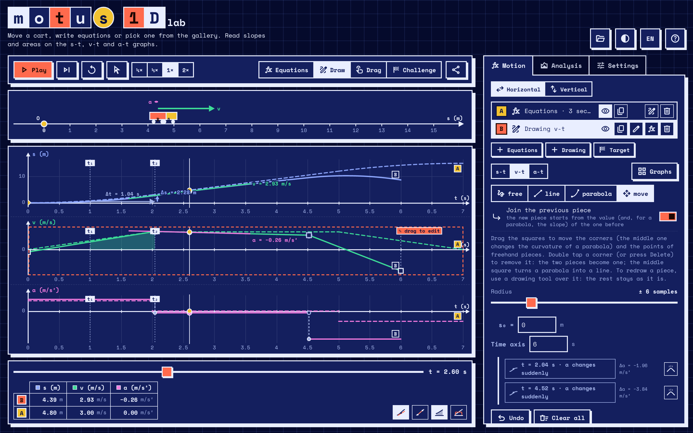
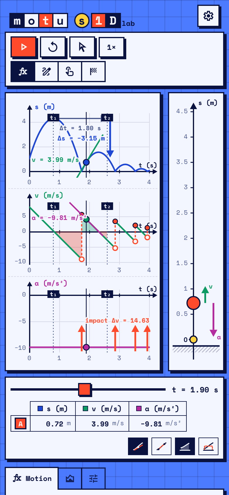
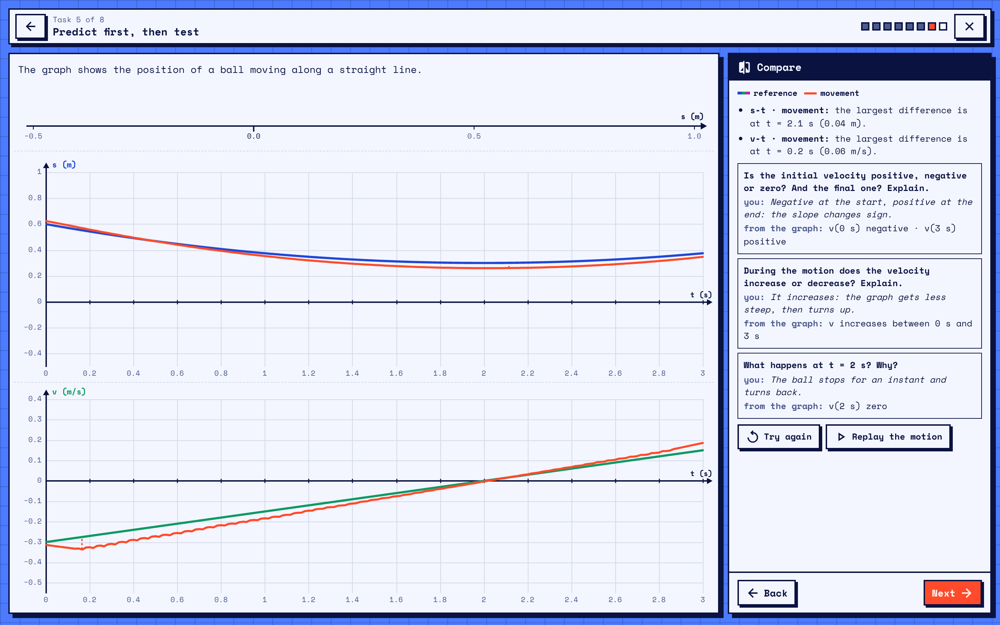
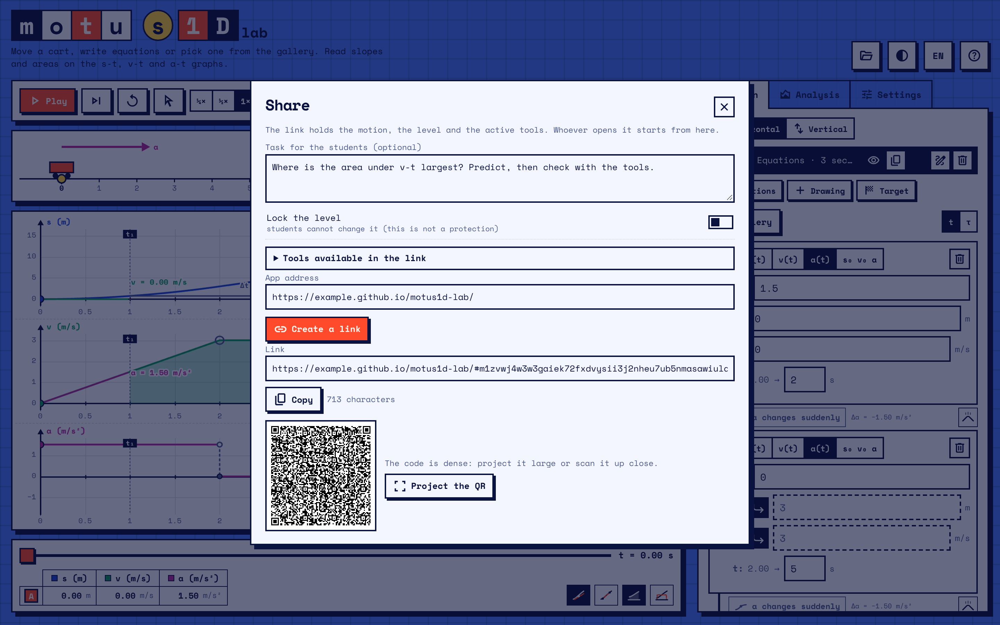

# Motus 1D Lab



Motion along a line, for the physics classroom. Move a cart with your finger, write the equations, or draw a graph: whichever way you start, you get the same motion, and the s‑t, v‑t and a‑t graphs stay linked at every instant.

The app is meant to make two ideas hard to miss: **slopes** (v is the slope of s‑t, a is the slope of v‑t) and **areas** (the area under v‑t is Δs, the area under a‑t is Δv).



It runs in the browser, on a computer, a tablet or a phone. You don't need an account, nothing to install, and nothing leaves the device unless you share a link. Fonts and icons ship with the app, so once it's loaded it doesn't depend on any other server. The interface is in Italian and English.

<!-- Live version: add the GitHub Pages link here once Pages is on, e.g. https://<user>.github.io/motus1d-lab/ -->

---

## Four ways to make a motion

**Equations.** A motion is a list of sections, each one with its own time interval. A section can be given as:

- s(t);
- v(t) plus the initial position;
- a(t) plus the initial position and velocity;
- constant s₀, v₀ and a.

Initial conditions can carry over from the previous section. Any letter that isn't t (A, ω, v0, k…) becomes a parameter with its own slider. Expressions accept `+ − * / ^`, implicit products (`2t`, `A sin(ω t)`), `sin cos tan exp ln sqrt abs min max if`, π and e. Inside a section you can also use local time τ = t − t₁.

**Drawing.** Draw the s‑t, v‑t or a‑t graph directly, freehand or with lines and parabolas, and set the initial conditions. The other two graphs follow. With the move tool you can:

- drag the corners;
- bend a parabola from its middle point;
- push the points of a freehand piece;
- double tap a corner (or press Delete) to remove it.

To redraw only part of a graph, draw over it: whatever comes after is kept.

**Drag.** Grab the cart on the track and move it while recording. Your hand is never perfectly smooth, so a‑t gets noisy; the smoothing slider fits a small parabola around each point and reads s, v and a from it. Turn it down and a‑t falls apart — that is a good thing to show students. Recorded samples can be edited afterwards on any of the three graphs.

**Challenge.** Pick a target graph, wait for the countdown, and move the cart so its graph traces the target. You get a score and can keep your attempt as a motion.

There are also two **galleries** to start from: one of equations (uniform motion, braking, out and back, a teleport, an oscillation, a throw, a drop…) and one of drawn graphs.



## Reading the graphs

- **Secant and tangent**: the average slope between t₁ and t₂, and the slope at the cursor, with Δt and Δs (or Δv) drawn as arrows.
- **Areas** under v‑t and a‑t, as an exact integral, Riemann sums (left, midpoint or right, with an adjustable number of rectangles) or trapezoids.
- **Mean-value rectangle**: same area as the curve, and you can see the parts that cancel out.
- **Joints between sections** are checked and labelled:
  - smooth;
  - acceleration changes suddenly (an acceptable idealisation);
  - velocity jump (it would need infinite acceleration);
  - position jump (the cart teleports);
  - impact (a bounce, on purpose).

  An impossible joint can be blended into a smooth one.
- **Predict**: hide one graph, sketch what you expect, then reveal it and get a score.
- **Motion diagram and strobe** on the track: positions at equal time steps, with v and Δv arrows.
- **Values table** under the graphs. Tap a column to hide a graph, a cell to hide one curve, or a letter to open the actions for that motion.

## Several motions at once

Each motion gets a letter (A, B, C…) and appears dashed when it isn't the active one. Where two motions meet, the app marks the time and place.

- Equations convert to drawings, and drawings made of lines and parabolas convert back to equations. Recordings can be duplicated, edited, hidden or deleted.
- To act on a motion right where it is drawn, press and hold its curve or its cart, use the pointer tool in the toolbar, or tap its letter in the table. A small row of icons opens next to it.
- Hiding a motion hides everything drawn from it: curves, areas, slopes, its cart. Deleting is immediate, with an Undo bar. ⌘Z / Ctrl+Z undoes any change in the scene, and ⇧⌘Z / Ctrl+Shift+Z redoes it.



## Vertical motion and free fall

Switch the track to vertical for throws and drops. There is a floor at height 0, where the ball bounces (with a coefficient of restitution) or stops. Impacts show up as spikes on a‑t and jumps on v‑t.

In Drag mode you can also throw the ball by hand and let gravity take over.



## Reference frame

Move the origin (or drag O on the track) and flip the direction of the axis. The motion itself stays put: only the numbers change, and the equations are rewritten to match. You can call the position s, x or r on a horizontal track, and s, y or h on a vertical one.

## Activities: predict, discuss, compare

Besides free exploration, the app has a mode for **group work**. One student holds the device and acts; the others watch, predict and discuss. The button with the mortarboard opens it.

An activity is a sequence of short tasks, and each task moves between representations of a motion: movement, words, graphs and equations. Each task is a sequence of steps:

- **look** at what is given (a description, an equation, a graph);
- **think alone** before anyone touches the device, with an optional timer;
- **answer** questions in words, on screen or on paper. Short numeric answers and quick choices are also available;
- **discuss** in the group;
- **act**: move the ball on a short track, or draw a graph. Recording starts and stops with a button or the R key, or runs while either is held. The clock starts when the ball is grabbed;
- **reveal** the reference graphs, one at a time if needed;
- **compare**: the group's answer, earlier attempts and the reference, on the same axes;
- **reflect**, with a clean view of the graphs for copying them onto paper.

Groups can also:

- record or draw an **alternative B** when they disagree, compared separately;
- **pass the device** between roles, with private screens (for example, one student enters a function the others must not see);
- write an **equation** as their answer;
- make a **group board**: an image of the task with the graphs, the comparison and their answers, to show fullscreen or to save and hand in.

The teacher can make each reveal wait for a short code, so the class reveals together; the codes are listed on the activity's card.

The comparison never gives a score. It points out what differs and where, for example:

- an interval where the graph rises instead of falling;
- the largest gap;
- the same shape shifted in time;
- a corner the hand can't follow;
- the same velocity starting from another position.

What the group wrote sits next to what the reference shows (for example, "v(2 s) zero"). Groups can try again as often as they want, and every attempt is kept. Question answers stay as they were before the reveal.

The app comes with a ready-to-use activity on position, velocity and acceleration graphs, which ends with a role game. An activity can be shared as a link, or written as a JSON file and imported. The format is described at the top of `js/pdc.js`, and an example is in `js/activities.js`. Every text in an activity can be given in Italian and English. Progress is saved on the device.



## Levels and sharing with students

Four levels decide which tools are visible:

1. s‑t only, secant and average velocity.
2. Adds v‑t, tangent, area under v‑t and the mean value.
3. Adds a‑t, area under a‑t, a(t) sections and blending.
4. Everything, including Riemann sums, trapezoids and τ.

**Share** turns the current scene into a link. The link carries the motions, the level, a task for the students and, if you want, a hand-picked set of tools. You can lock the level; this keeps things tidy and is not meant as a protection. Each link also has a QR code you can project. Post the link wherever your class finds its materials, and students open the app exactly where you left it.



## Everything else

- **Scenes**: several saved setups in the same browser, to switch between, duplicate or rename.
- **Export**: the data as CSV, and the graphs as an image.
- **Settings**:
  - Italian or English;
  - light, dark or system theme;
  - number of decimals;
  - name of the position;
  - which hand you drag with (it moves the vertical track and the record button to that side).

## Keyboard

| Key | What it does |
| --- | --- |
| Space | play / pause |
| ← → | step in time |
| R (hold) | record in Drag mode |
| Z | undo the last drawn piece |
| ⌘Z / Ctrl+Z | undo |
| ⇧⌘Z / Ctrl+Shift+Z / Ctrl+Y | redo |
| Delete | remove the last touched corner of a drawing |
| Esc | close the action icons, the pointer tool or sample editing |

## Running it

It's a static site with no build step. ES modules don't load from `file://`, so serve the folder:

```sh
python3 -m http.server 8000
# then open http://localhost:8000
```

To publish it on GitHub Pages, go to *Settings → Pages* in the repository, choose *Deploy from a branch*, then `main` and `/ (root)`. Share links always point to the address the app is opened from.

## How it's made

Plain JavaScript modules, one HTML file with the styles, and no dependencies to install.

| File | What's in it |
| --- | --- |
| `index.html` | markup and styles |
| `js/main.js` | state, panels, interaction, scenes, undo, sharing |
| `js/model.js` | sections → motion model, joints, blending, smoothing, free fall |
| `js/draw.js` | drawn graphs: lines, parabolas, freehand, editing |
| `js/parser.js` | the expression parser |
| `js/views.js`, `js/plot.js` | graphs and track, drawn on canvas |
| `js/analysis.js` | Riemann sums, meeting times, interval statistics |
| `js/gallery.js`, `js/levels.js`, `js/i18n.js`, `js/icons.js`, `js/share.js` | presets, levels, IT/EN strings, icons, link encoding |
| `js/inflate.js` | a small DEFLATE decoder, so links open on older Safari too |
| `js/pdc.js` | activities: the step runner, recording, drawing, comparison |
| `js/activities.js` | the built-in activities |
| `js/vendor/qrcode.js` | QR codes |
| `fonts/` | Space Mono and a cut-down Material Symbols, with their licenses |

Scenes are saved in the browser's local storage. Share links are compressed and stored after the `#`, so they never reach a server.

## Credits

- QR codes: [qrcode-generator](https://github.com/kazuhikoarase/qrcode-generator) by Kazuhiko Arase, MIT license.
- Fonts: [Space Mono](https://fonts.google.com/specimen/Space+Mono) (SIL Open Font License) and [Material Symbols](https://fonts.google.com/icons) (Apache 2.0), both by Google, bundled in `fonts/`. The icon font is cut down to the icons the app uses, so it weighs 17 KB.

## License

MIT, see [LICENSE](LICENSE).

---

Vibecoded with <3
