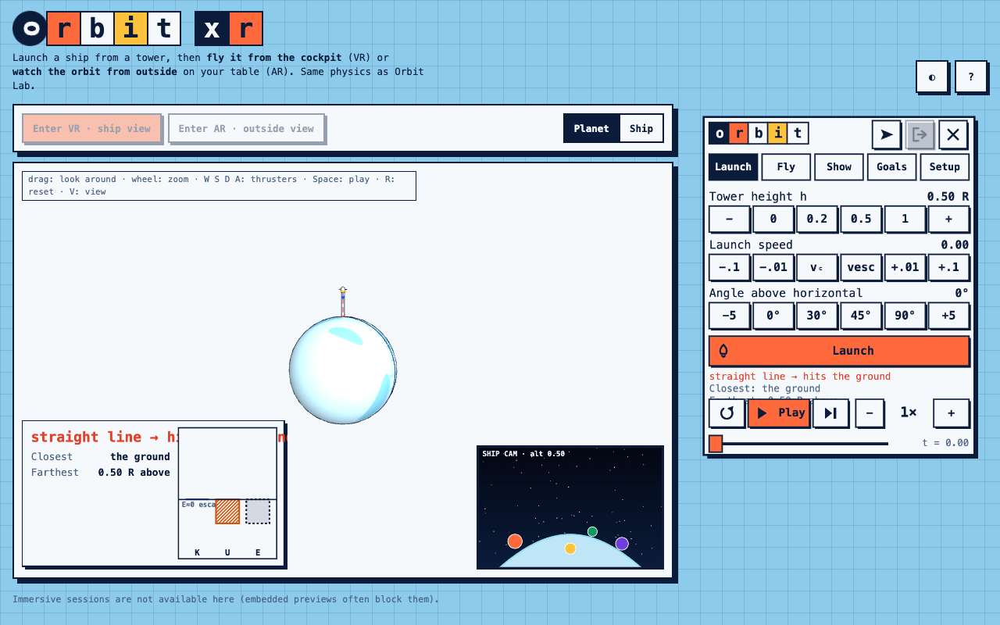

# Orbit Lab XR (draft)



WebXR version of **Orbit Lab** (the 2D app in `../orbit-lab`), built the way `surface-lab-xr` is: static site, no build step,
Three.js r128 bundled, everything offline (the Quest is not on the network).

- **VR (`immersive-vr`) → ship view.** You sit in a cockpit. Up = away from the planet, forward = direction of motion. The planet and stars turn around you as you orbit.
  Green circle = prograde, red cross = retrograde. Loose objects float while you coast and drift backward when you burn.
- **AR (`immersive-ar`) → outside view.** The planet, tower, ship, predicted orbit, trail and vectors float on your table. Grab it to move, turn, scale. A "Ship cam" inset shows the cockpit view.
- **Screen (desktop / phone).** Same scene, drag to orbit, wheel to zoom; Planet / Ship toggle; the same control panel as in the headset, drawn in the page.

## Run
```bash
python3 -m http.server 8000      # in this folder, then open http://localhost:8000
```
Quest over USB: `adb reverse tcp:8000 tcp:8000`, open `http://localhost:8000` in the Quest Browser (same as Superfici 3D).
Tests (plain Node, no install): `cd tests && npm test`.

## What is in (from Orbit Lab)
Tower height, launch speed (with `vc(h)` / `vesc(h)` snaps) and angle · Play / Pause / Step / speed ¼×…32× / rewind scrubber (branching history) ·
prograde / retrograde / radial thrusters (hold = burn, tap = fixed Δv step) · predicted conic (circle, ellipse, ≈parabola, hyperbola, impact) with
closest / farthest points · velocity, gravity, thrust, net-acceleration arrows · trail, ghost trails, grid, Kepler strobe · energy bars K, U, E ·
readouts · levels 1–3 · missions 1–6 (predict → observe → explain) · real-planet units (display only).

## Left out of this draft
Thrust-program mode (and mission 7), plots tab (r(t), v(t), V_eff), CSV export, teacher feature switches, share link, equal-area wedges, no-gravity ghost, numbers on arrows.

## Controls in the headset
Trigger or hand-ray pinch presses panel buttons (hold a thruster button to burn; a tap = one Δv step). Fingertip poke also works. Grip or pinch near the planet (AR view),
near a panel edge, or on the readout card to move it; two hands scale. Controllers: **A / B** = prograde / retrograde, **X / Y** = radial out / in (held), **stick press** = hide / show the panel.

## NOT verified on the headset
Nothing XR was run on a Quest; only the desktop view, the pure logic and simulated rays / pokes were checked here.
- Gamepad indices (A/B/X/Y = 4/5 per hand, stick press = 3) and the left/right mapping.
- Hand ray pose, pinch thresholds, poke feel, panel size and distances (`HOME`, `POSES` in `app.js`).
- Ship scale (`SHIP_SCALE = 300` m per unit), depth precision of the planet at hundreds of metres, comfort of the rotating sky (no vection mitigation).
- AR passthrough transparency and light palette legibility in a real room; panel readability of the 21 px text.
- Frame rate with the trail ribbon (up to 2500 points) and the panel texture refresh (~12 Hz).
