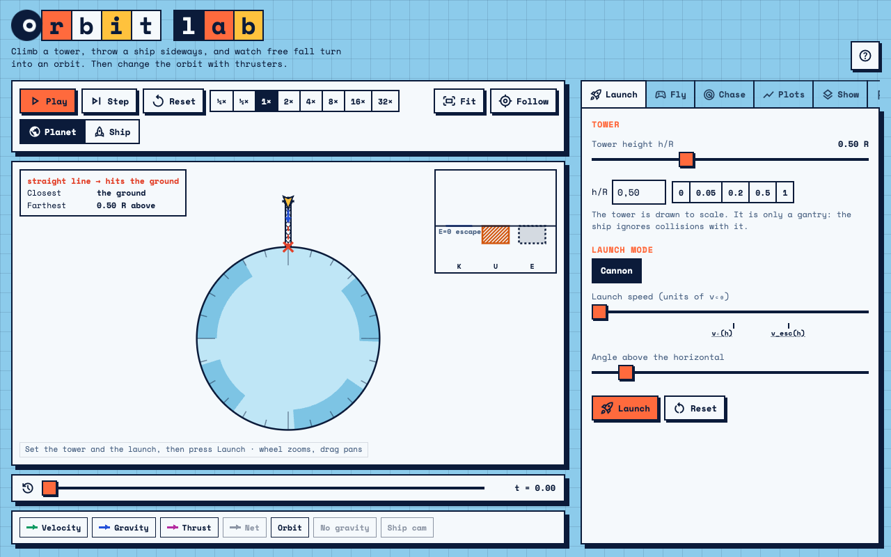

# Orbit Lab



An interactive simulator for exploring what an orbit is: free fall around a planet. Launch a ship from a tower of adjustable height, watch the trajectory, change it with thrusters, and read the physics from vectors, energy bars and a live predicted orbit. Built for phones, tablets and desktops.

Built with vanilla JavaScript (native ES modules), Canvas 2D, no framework and no dependencies. Fonts: Space Mono and Material Symbols from Google Fonts (the page still works offline, with a system monospace font and text instead of icons).

Vibecoded with Claude, with <3.

## What it does

- **Tower and launch.** A tower of height $h/R$ from 0 to 1.5, drawn to scale. Launch as a *cannon* (speed and angle, with marks at the local circular speed $v_c(h)=1/\sqrt{1+h}$ and escape speed $\sqrt2\,v_c(h)$) or with a *thrust program* (draggable plots of thrust and pitch over a burn).
- **Predicted orbit.** The dashed conic from the current state (circle, ellipse, parabola, hyperbola, straight line, or hitting the ground), with the closest point, the farthest point and the impact point marked.
- **Thrusters.** Prograde, retrograde, radial out and radial in, by hold (continuous burn) or click (fixed $\Delta v$ step). A label says whether the ship is thrusting forward or backward.
- **Time.** Play, pause, step, speed from ¼× to 32×, and a scrubber to rewind. Acting from a past moment starts a new branch. Ghost trails of earlier attempts and a no-gravity ghost show where the ship would be without gravity.
- **Representations.** Velocity, gravity, thrust and net-acceleration arrows (linear or square-root length); energy bars for $K$, $U$ and $E$ with the escape line; plots of $r(t)$, $v(t)$ and the energies; effective potential; Kepler strobe copies and equal-area wedges; a ship cam with the horizon and cabin objects floating while coasting.
- **Rendezvous (Chase).** A target ship on the same circular orbit, ahead or behind. Catching up is a lesson in orbital periods: a lower orbit has a shorter period.
- **Levels.** Level 1 is qualitative, level 2 adds numbers and units, level 3 adds $L$, the eccentricity vector, work by thrust, a $\Delta v$ budget and real-planet units. A teacher panel switches single features on or off; settings are kept in the browser and in the link (for example `?level=2&h=0.2`).
- **Missions.** Ten missions as data, each following predict, observe, explain.
- **Data.** CSV export of the trajectory ($t, x, y, v_x, v_y, r, v, K, U, E, L$).

## Run it

ES modules do not load from `file://`, so serve the folder:

```sh
python3 -m http.server 8000
# then open http://localhost:8000
```

### Single file

`tools/build-single-file.mjs` writes `dist/orbit-lab.html`, one self-contained page that also works from `file://` and can be published as a standalone page. It needs Node 18 or newer and no packages:

```sh
node tools/build-single-file.mjs
```

### Tests

Open `tests/index.html` through the local server. The checks cover the physics core: circular and elliptical orbits, tower speeds, escape, vis-viva, Kepler's third law, conservation over 100 orbits, work–energy with thrust, the burn-point lemma, impact, degenerate inputs and deterministic replay.

## Publish with GitHub Pages

Settings → Pages → Build and deployment → Deploy from a branch → `main`, folder `/ (root)`.

## Code structure

```
index.html            markup
css/tokens.css        colours, light and dark themes
css/base.css          reset, page, header, layout
css/components.css    buttons, tabs, toggles, sliders, tables, dialog, responsive rules
js/main.js            entry point: animation loop and start-up
js/state.js           application state and deterministic stepping
js/chase.js           rendezvous mode
js/strings.js         all user-facing text
js/util.js            DOM helpers
js/core/              pure physics, no DOM: constants, orbit, thrust, integrator, energy, history
js/render/            canvas view, vectors, energy bars, plots, ship cam
js/ui/                controls, panels, levels, teacher panel, missions, persistence
js/data/              missions, planets, levels
tests/                core tests (run in the browser)
tools/                single-file build script
```

## Physics notes

- Units: $\mu = GM = 1$ and planet radius $R = 1$. The circular speed at the surface is 1, the escape speed is $\sqrt2$, and a surface orbit lasts $2\pi$.
- Motion is two-dimensional in the orbit plane. The planet does not rotate.
- Integration: fourth-order Runge–Kutta with a step proportional to $r^{3/2}$, fixed tick of 0.01, no randomness and no wall-clock time in the core, so replay is exact. Energy drift is about $10^{-11}$ over 100 orbits at $e=0.9$.
- The tower is a drawing only: the ship ignores collisions with it.
- Impact is found by bisection inside the integration step, so the crash point lies on the surface.

## License

MIT, see [LICENSE](LICENSE).
