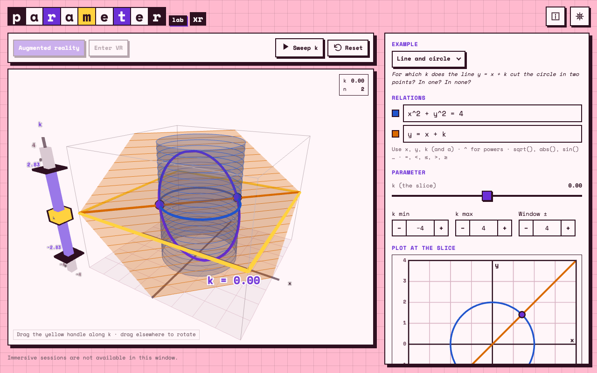

# Parameter Lab XR (prototype)

Parametric equations and inequalities **in augmented reality**. The (x, y) plane is extruded along the parameter k: every curve F(x, y; k) = 0 becomes a surface, every inequality a solid. A horizontal slice shows the plot for one value of k; with two relations, their intersections draw a curve in space and the **discussion** colours the k axis by the number of solutions, marking the critical values.

Runs in the Quest Browser (WebXR passthrough or VR, hands or controllers) and on a computer or phone. Interface in Italian and English, works offline. No build step: plain HTML, CSS and JavaScript, Three.js r128 bundled.

Part of the math and physics labs: the look and behaviour follow the shared [lab design standard](https://github.com/Bradwave/labs/blob/main/DESIGN.md).

## Features
- **One or two relations** in x, y, k (and a fixed parameter a): equations and inequalities in the same box, for example `y = x^2 - 2*k*x + k`, `x^2 + y^2 <= k`, `y >= x + 1`. Blue is the first, orange the second, violet is always the solution set.
- **Extruded view**: layers (the plane at many k), translucent surfaces, solids for inequalities, the intersection curve of the two surfaces.
- **The slice**: a yellow plate you move along k (handle, slider, thumbstick, sweep). The plot of the slice is on the panel with the intersection points and their coordinates.
- **Discussion**: the k axis coloured by the number of intersections, with the critical values (tangencies, found exactly with Newton's method) marked; touch the bar or a chip to jump there; the slice snaps near them. It can be **hidden** so students predict first.
- **Eleven examples** with a guiding question each (line and circle, roots of a quadratic, pencil of lines and parabola, two circles, hyperbola and circle, an irrational equation, absolute value, x³ − 3x = k, concentric circles, disc and half-plane, a region between parabola and line).
- **Low cognitive load**: three colours with fixed meanings, "Slice only" dims the 3D to look at one plot, layers and surfaces can be hidden, a short panel in the headset.
- Links (`#a=…&b=…&k=…`), "Copy the link", QR code and "Copy the discussion" in the settings menu.

## Run
Serve the repository root and open `/parameter-lab-xr/`. Headsets need HTTPS (the published site) or `adb reverse` for a local server.

## Structure
`js/expr.js` (parser), `js/engine.js` (contours, surfaces, intersections, discussion), `js/presets.js`, `js/app.js` (scene, panel, input), `tests/engine.test.mjs` (`node tests/engine.test.mjs`). See `CLAUDE.md` and `docs/PLAN.md`.

## Status
Prototype: everything XR is **unverified on the Quest** (button indices, hand joints, panel legibility, comfort of the handle gesture). Next steps are in `docs/PLAN.md`.

## Licence
MIT, see [LICENSE](LICENSE). Space Mono font: SIL Open Font License (`../kit/fonts/LICENSES.txt`).

Vibecoded with Claude, with <3.
