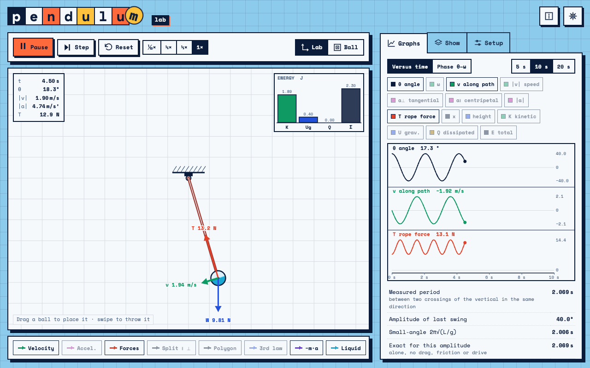

# Pendulum Lab



An interactive pendulum simulator for teaching physics, built for phones and desktops. Interface in Italian and English, light and dark themes, works offline and installs as an app. No build step, no dependencies: plain HTML, CSS and JavaScript modules. Vibecoded with Claude, with <3.

Part of the math and physics labs: the look and behaviour follow the shared [lab design standard](https://github.com/Bradwave/labs/blob/main/DESIGN.md).

## Features

- **Three ropes**: rigid rod (pulls or pushes), string (goes slack and snaps tight), elastic rope (T = k(r − L)).
- **Place and launch** the ball by dragging; swipe to throw it. Pause, step, slow motion (⅒× to 1×).
- **Forces on the ball**: weight, rope force, drag and friction, spring force, net force; components along and across the rope; force polygon.
- **Newton's third law**: forces on the rope, on the support and on the Earth, with numbered pairs.
- **Ball view (non-inertial frame)**: the camera rides on the ball, the apparent force −m·a appears (centrifugal + tangential parts), frame acceleration and effective gravity g − a.
- **Liquid in the ball**: a simple sloshing surface or a 2D particle fluid that shows the apparent forces.
- **Energy bars**: kinetic, gravitational, elastic, spring, dissipated, work of the drive, total.
- **Graphs** of every quantity versus time, phase plot θ–ω, measured period versus the small-angle and exact formulas, CSV export (in Italian with `;` and decimal comma, ready for Excel).
- **Pivot friction**, **air drag ∝ v²**, **viscous friction ∝ v**, adjustable g with planet presets.
- **Second pendulum**, independent or coupled by a spring (normal modes and energy transfer).
- **Driven support**, horizontal or vertical: resonance, chaos, Kapitza's inverted pendulum.
- **Phone on the ball**: accelerometer (with or without g) and gyroscope readings with phyphox-style axes, to compare with real data.

## Run it

Open the published page, or serve the folder locally (ES modules do not load from `file://`):

```sh
# from the repository root (the page loads the shared ../kit)
python3 -m http.server 8100
# then open http://localhost:8100/pendulum-lab/
```

## Publish

Published with the other labs at labs.matephis.com/pendulum-lab/ (GitHub Actions, see the repository root).

## Code structure

```
index.html          markup and the info dialog
css/app.css         palette and pendulum-specific styles
kit/                not in this folder: the shared lab kit lives in `../kit/`
sw.js, manifest.webmanifest   offline and install (generated)
js/main.js          entry point: kit start-up, animation loop
js/strings.js       every interface string in Italian and English
js/state.js         parameters (P), display switches (LY), state (S), pendulums (PEN)
js/physics.js       forces, tension, driven support, RK4 integration, slack/snap
js/fluid.js         liquid models (surface and particles)
js/data.js          recorded quantities, period detection, phone sensor
js/view.js          canvas, colours, camera and coordinate transforms
js/render.js        drawing of the scene, arrows, polygon, energy bars
js/panels.js        readouts, graphs, period table, CSV
js/interaction.js   dragging, throwing, releasing, resetting
js/ui.js            buttons, tabs, sliders, toggles
js/util.js          shared helpers
tests/              node --test
```

## Physics notes

- Ropes and rods are massless; the ball is a point mass for the dynamics.
- Integration: fourth-order Runge–Kutta, step ≤ 0.5 ms. Energy is conserved to better than 10⁻⁴ J without friction.
- The liquid does not act back on the motion of the ball.

## Tests

```sh
node --test tests/
```

## License

MIT, see [LICENSE](LICENSE). Space Mono font: SIL Open Font License (`../kit/fonts/LICENSES.txt`).
