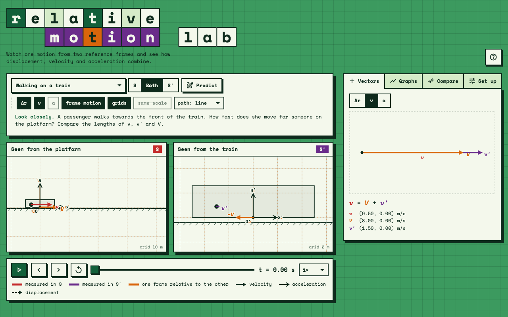

# Relative Motion Lab



An interactive web app for exploring the classical composition of motion: one object, described from two reference frames side by side.

Frame **S** is fixed. Frame **S′** moves relative to S: it can translate in any of several ways and, optionally, rotate. The motion of the object is given in one of the two frames and the app computes it in the other, showing positions, displacements, velocities and accelerations in both.

The app is written in plain JavaScript (ES modules), with no build step and no dependencies apart from two Google Fonts stylesheets (Space Mono and Material Symbols).

## Features

- **Two panels, one per frame.** Each panel keeps its own axes still; the other frame's axes and grid move past. Either panel can be shown alone.
- **Vectors.** Displacement since the start, velocity and acceleration of the object, plus the motion of each frame's origin relative to the other. Velocity arrows share one scale across both panels, and so do accelerations.
- **Paths** drawn as a line or as stroboscopic dots at equal time intervals.
- **Vector addition.** A head-to-tail diagram of
  - Δr = Δr′ + ΔR, v = v′ + V, a = a′ + A for translating frames;
  - v = V + v′ + Ω×r′ and a = A + a′ + 2Ω×v′ − Ω²r′ for a rotating S′.
- **Graphs** of x, y, vₓ and v_y against time in both frames, together with the motion of O′.
- **Same or different?** A live table comparing time, position, displacement, velocity, speed and acceleration in the two frames, with a note on whether S′ is inertial, accelerating or rotating.
- **Predict, then reveal.** The panel of the frame to be worked out hides the object; the user sketches the expected path and then replays the motion with the sketch on top.
- **Set up** your own motion: the motion of S′ (at rest, constant velocity, constant acceleration, uniform circular, oscillation), an optional rotation of S′, and the motion of the object in either frame.
- **Layouts for desktop, phone portrait and phone landscape**, with light and dark themes following the system setting.

## Scenarios

Each built-in scenario can be opened directly by adding its name after `#` in the address, for example `index.html#river`.

| Name | Scenario |
| --- | --- |
| `walk` | Walking on a train |
| `river` | Crossing a river |
| `rain` | Rain on a car window |
| `toss` | Ball tossed up on a train |
| `accel` | Ball on an accelerating train |
| `wheel` | Point on a rolling wheel |
| `ferris` | Ball dropped from a Ferris wheel (S′ translates along a circle) |
| `merry` | Ball across a merry-go-round (rotating S′) |
| `turntable` | Pen on a turntable (rotating S′) |
| `mars` | Retrograde motion of Mars |
| `custom` | Build your own |

## Running it locally

Browsers do not load ES modules from `file://` addresses, so opening `index.html` by double-clicking shows an empty page. Serve the folder instead:

```bash
python3 -m http.server 8000
```

then open <http://localhost:8000>.

## Publishing with GitHub Pages

1. Push the repository to GitHub.
2. In the repository, open **Settings → Pages**.
3. Under **Build and deployment**, choose **Deploy from a branch**, select `main` and the `/ (root)` folder, and save.

The site appears at `https://<user>.github.io/relative-motion-lab/` after a minute or two.

## Project structure

```
index.html        page markup
css/style.css     styles, themes and responsive layouts
js/
  main.js         animation loop and start-up
  dom.js          DOM query helpers
  vec.js          2D vector helpers and shared constants
  motion.js       motion models and the change of reference frame
  presets.js      built-in scenarios
  state.js        application state, units and loading a scenario
  canvas.js       canvases, colours and coordinate maps between frames
  layout.js       fitting the view to the motion and sizing the panels
  panels.js       drawing a frame panel
  vectors.js      vector-addition diagram
  graphs.js       graphs against time
  compare.js      same-or-different table and frame message
  setup.js        set-up panel
  predict.js      predict, then reveal
  controls.js     toolbar, tabs, transport and keyboard
```

`motion.js` holds all the physics. Every quantity is computed analytically at any instant, so pausing, stepping and scrubbing are exact and the paths are redrawn from the formulas rather than recorded.

## The physics

Let R, V, A be the position, velocity and acceleration of the origin O′ measured in S, θ the angle of the axes of S′ and Ω = dθ/dt (constant). With r′, v′, a′ measured along the axes of S′ and Rot(θ) the rotation by θ:

```
r = R + Rot(θ) r′
v = V + Rot(θ) (v′ + Ω×r′)
a = A + Rot(θ) (a′ + 2Ω×v′ − Ω² r′)
```

With Ω = 0 these reduce to the Galilean rules r = R + r′, v = V + v′, a = A + a′.

## Keyboard

<kbd>Space</kbd> play or pause, <kbd>←</kbd> <kbd>→</kbd> step, <kbd>Home</kbd> back to the start.

## License

No license has been chosen yet. Add a `LICENSE` file before sharing the repository publicly if you want others to be allowed to reuse the code (MIT is a common choice for small educational tools).
