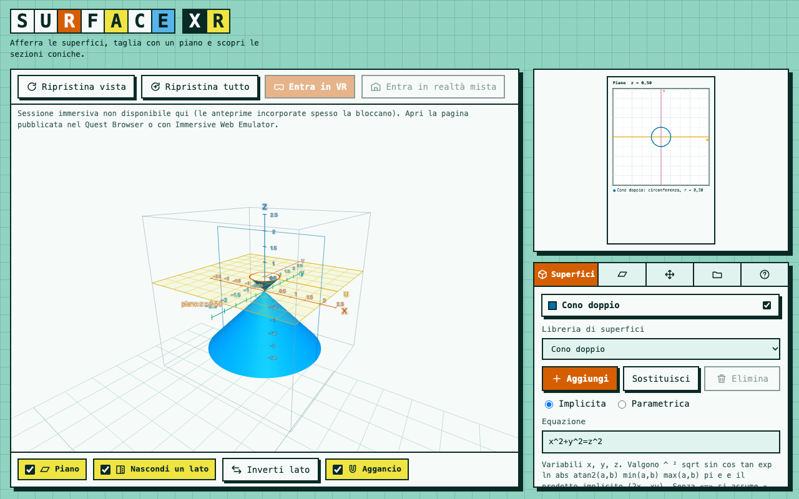

# Surface Lab XR (Superfici 3D) — WebXR prototype (M0–M3 + surface library)

Explore quadric surfaces and conic sections in 3D, on desktop or on a Meta Quest 3 (hands or controllers).
Static site: **no build step, no dependencies to install** (Three.js r128 is bundled).

## Files
| File | Purpose |
|---|---|
| `index.html` | page + interface |
| `core.js` | equation parser, surface meshing, plane sections, conic classification (no dependencies) |
| `grab.js` | grabbing logic (one hand: move/rotate, two hands: scale/rotate) |
| `app.js` | scene, objects, snapping, panels, WebXR |
| `three.min.js` | Three.js r128 (MIT) |
| `sw.js`, `manifest.webmanifest`, `icon*` | offline / PWA |
| `tests/` | headless tests for the maths and the grab logic |

## Run on your computer
From this folder: `python3 -m http.server 8000`, then open `http://localhost:8000`.
`localhost` counts as a secure context, so WebXR and the service worker work without certificates.
(Opening `index.html` by double-click also shows the desktop mode, but not the service worker.)

## Test without a headset
Install the *Immersive Web Emulator* extension (Meta) in Chrome/Edge, open `http://localhost:8000`, use the extension's
panel to simulate headset, hands or controllers, and press **Entra in VR**.

## Test on the Quest 3
WebXR needs **https** (or `localhost`). Options:
1. **Upload to your site** (e.g. a subdomain with GitHub Pages / Cloudflare Pages / your host) and open the URL in the Quest Browser.
2. **USB-C + adb** (needs developer mode): `adb reverse tcp:8000 tcp:8000`, then open `http://localhost:8000` in the Quest Browser.
3. Same wifi: `https` tunnel (e.g. a dev tunnel) to the server above.

## Offline in class
1. Open the https URL once per headset while online (phone hotspot is fine).
2. The service worker caches all files. Turn wifi off, relaunch, and **check it still works** (check again after Horizon OS updates).
3. When you publish a new version, change `VERSION` in `sw.js`. If the site is behind Cloudflare, make sure `sw.js` and `index.html` are not cached aggressively (Cache-Control: no-cache), or headsets won't see updates.

## Controls
- **Desktop:** drag to orbit, wheel or two fingers to zoom; panels on the left and right.
- **Hands:** pinch (thumb + index) near an object.
  - on a **surface** → moves only that surface; on an **axis** → moves the whole scene; on the **plane** (away from surfaces and axes) → moves the plane.
  - pinch with the **other hand anywhere** → scale (surfaces and scene only) and rotate.
- **Equations in VR:** on the *Superfici* tab, "Scrivi l'equazione" opens an on-screen keyboard in the panel.
- **Scene link and QR:** the *Scene* tab shows a QR code of the scene (for phones/tablets that can reach the app's address) and an `adb` command that opens the scene on the Quest.
- **Scenes:** tab *Scene* (desktop) and *Scene* in the VR panel: save, open, built-in lessons, undo, copy/paste a scene code. Saved scenes live in the browser of each device.
- **Controllers:** grip (side button) to grab, trigger to point and press (ray), B/Y to hide or show the panel. Hands: pinch near an object to grab; point with the ray and pinch to press or select. Open the page with `?monitor=1` to see the raw buttons in VR.
- The open hand highlights the object that would be grabbed.

## Surface library (45 presets)
The **Libreria di superfici** menu groups them: quadrics, cylinders and planes, tori, spirals and helices (helicoid, spring, Archimedean spiral wall, shell, Dini), minimal surfaces (catenoid, Enneper, Scherk), ribbons and non-orientable surfaces (Möbius, 3 half-twists, full twist, Klein bottle), surfaces of revolution (vase, pseudosphere, Gabriel's horn), famous cubics and quartics (Cayley, Steiner Roman, Whitney, Plücker conoid…), graphs of functions (monkey saddle, Gaussian, ripples, eggbox) and periodic surfaces (gyroid, Schwarz P and D).
**+ Aggiungi** puts the chosen one in the scene (up to 6 at once); **Sostituisci** replaces the selected one. Every preset can be edited afterwards.

## Parametric surfaces
Switch to **Parametrica** and type x(u,v), y(u,v), z(u,v) with ranges for u and v (they accept `pi`, e.g. `2*pi`). Example sphere: `cos(u)*sin(v)`, `sin(u)*sin(v)`, `cos(v)` with u from 0 to `2*pi`, v from 0 to `pi`.
Sections of parametric surfaces are drawn exactly; they are not classified as conics (shown as «curva di sezione»). Implicit quadrics get the conic classification.

## Equations
Variables `x y z`; `^` or `²`; `sqrt sin cos tan asin acos atan sinh cosh tanh exp ln log abs sign floor atan2(a,b) min(a,b) max(a,b)`; `pi`, `e`; implicit product (`2x`, `xy`, `x(y+1)`).
`z = x^2 - y^2`, `x^2+y^2=z^2`, `x^2/4+y^2/9-z^2=1`. Without `=`, `… = 0` is assumed.

## Tune by feel (once you try it on the headset)
- `grab.js`: `smooth` (28, higher = less lag, more jitter), pinch thresholds in `pinchUpdate` (2.2 cm on / 3.5 cm off).
- `app.js` → `pick()`: `REACH_SURF`, `REACH_AXES`, `REACH_PLANE` (metres); `SNAP_ANG` (6°), `SNAP_STEP` (0.25); `DEF_SCALE` (0.16 m per unit).

## Tests
`cd tests && npm install && npm test` (needs Node; installs `three` only for the tests).

## Known limits (next milestones)
Domain box dragging (M4), parameters with 3D sliders (M5), in-VR panel to pick surfaces/enter equations, QR/phone equation entry.
