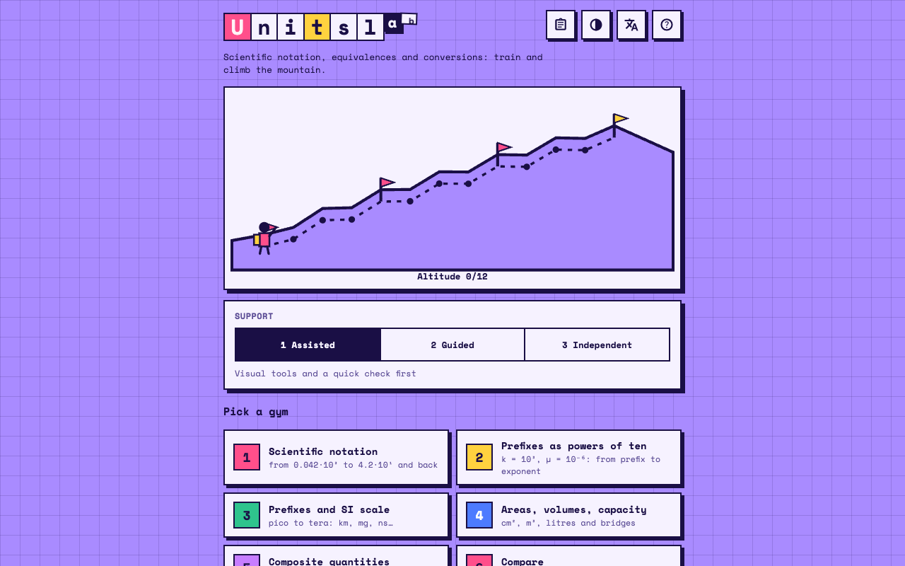

# Units Lab



Practice with scientific notation, unit equivalences and conversions (base and composite units), climbing a mountain one correct answer at a time.

Built with vanilla JavaScript (ES modules), no build step and no dependencies. Fonts (Space Mono, Material Symbols subset) travel with the app, so it works offline.

Vibecoded with Claude, with <3.

## What it does

- **Seven gyms and a mixed challenge.** 1 scientific notation · 2 prefixes as powers of ten (k = 10³, µ = 10⁻⁶) · 3 prefix conversions · 4 areas, volumes and capacity · 5 composite quantities (km/h, g/cm³, L/min, N/cm²) · 6 compare (order measures, find the odd one out) · 7 orders of magnitude (mantissa 5 or more rounds up) · a 12-question mixed challenge.
- **Exact numbers.** Values are digit strings with an exponent (BigInt), never floats. The result keeps the significant figures of the data; when it is not exact it is rounded half-up. Trailing zeros of an integer written without a decimal separator are not significant (`5200` has 2 figures, `5200,` has 4).
- **Both notations.** `5,2·10^3`, `5,2*10^3`, `5,2e3`; decimal comma in Italian, decimal point in English. A lone `1.000` is refused as ambiguous.
- **Data in scientific notation too.** Exercises start from decimal or scientific data, sometimes not normalized (`0,042·10^-3`), and ask for decimal or scientific results.
- **Three support levels.** 1 assisted: a prediction first ("bigger or smaller?"), visual aids and a live invariance badge. 2 guided: mantissa and exponent in separate boxes. 3 independent: the task only, with an optional hint. The app suggests a level change after a few answers; it never penalizes a hint.
- **Visual feedback.** Sliding comma on the digits with a ghost of its starting position and a shift counter; balance bars (one big tile against many small ones, same length); prefix scale and exponent line; composite units by substitution (`km/h = 10³ m / 3600 s`) with unit factors as an alternative view; mantissa bar for the order of magnitude; power substitution `cm³ = (10⁻² m)³ = 10⁻⁶ m³`; greyed filler zeros; log line for ordering. The method can be replayed after every answer.
- **Diagnosis, not just right/wrong.** Typical misconceptions are modelled (wrong direction, exponent sign flipped, exponents added instead of subtracted, exponent not multiplied by 2 or 3, rounding at 5 versus √10, time treated as decimal, litre bridge, m/M/µ swap, forgotten or doubled shift, off by one, not normalized, wrong figures, truncation) and named in the feedback.
- **The climb.** Right answer: up one station. Wrong: down one, never below the last base camp (every 4 stations). Value right but form off (figures, normalization): stay.
- **Statistics.** Accuracy over the last 20 answers per gym, most frequent errors, JSON export, printable summary sheet. Everything stays in the browser (`localStorage`).

## Run it locally

ES modules do not load from `file://`, so serve the folder:

```bash
cd units-lab
python3 -m http.server 8000
```

then open <http://localhost:8000>.

## Tests

```bash
npm test        # or: node --test
```

The numeric engine, checker, misconception models, generators, visuals and state logic are pure modules tested with the Node test runner (no dependencies).

## Link parameters

| Parameter | Effect |
|---|---|
| `lang=it` / `lang=en` | interface language |
| `level=1..3` | fixes the support level and locks the selector |
| `modules=1,2,3` | only the listed gyms (1-7) |
| `tier=1..3` | unit difficulty: 1 SI and prefixes, 2 + common units, 3 + advanced units |
| `seed=N` | reproducible sequence of exercises |

Example: `index.html?lang=it&level=2&modules=1,2`.

## Code structure

```
index.html            markup, dialogs
css/style.css         tokens, components, layouts
js/
  decimal.js          exact decimals, significant figures, rounding, parsing
  units.js            unit catalogue with exact factors, prefixes, parsing, labels
  format.js           locale-aware writing (decimal, a·10^n, a e n)
  rng.js              seeded random generator
  generator.js        procedural exercises (modules 1-7)
  errors.js           misconception models
  checker.js          value, form, figures, rounding, diagnosis
  visuals.js          HTML/SVG builders for the visual feedback
  input.js            keypad and mantissa/exponent widget
  climb.js            mountain and climber
  state.js            progress, statistics, adaptive level, link parameters
  i18n.js             all strings (it, en)
  main.js             screens and question flow
data/contexts.js      catalogue of real-world contexts (one entry = one situation)
tests/                node --test files
fonts/                Space Mono, Material Symbols subset
```

## Adding contexts

Each entry in `data/contexts.js` has a module (3 prefixes, 4 area/volume/capacity, 5 composite), a natural unit, a plausible range (or a `fixed` written value for constants), the number of figures, and alternative units. Set `rev: true` once the values have been checked. The tests verify that every unit parses and has the right dimension.

## Publish with GitHub Pages

1. Push the repository to GitHub.
2. **Settings → Pages**, deploy from branch `main`, folder `/ (root)`.
